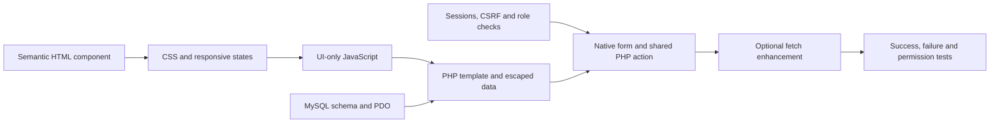

# Build order and genuine team contributions

This is a practical route through **FinalSubBackup**, for a team working toward a deadline. The four stages describe responsibility and learning; they can overlap. The existing working application is a **Codex-assisted baseline**. Use it as a reference, preserve its working features, and record what each person actually studies, changes, tests and reviews.

Source inspected: commit `b01fc8b`, on **3 November 2026 (Asia/Colombo)**. Existing behavior and proposed gaps below refer to that baseline; check the current branch before selecting a task.

You can reuse baseline code with its provenance and assistance disclosed under your course policy. Copying an unchanged module does not establish new implementation or independent authorship. A useful reviewed fix, a meaningful test, a verified investigation or an explanation in your own words can produce real evidence. The lecturer determines what meets the assessment's originality and contribution requirements.

[Start / setup](../README.md) · [Architecture](architecture.md) · [API contract](api.md) · [Contribution log template](contribution-log.md) · [Assignment requirements](requirements-traceability.md)

## 1. The order everyone should follow

**First shared target:** register → sign in → browse clubs → apply → administrator approves → student sees approved status and can enter the club community.

Do that complete journey before expanding your work across every page. It connects all five required technologies and both roles.

| Checkpoint | Frontend work | Backend / database work | Evidence needed before proceeding |
|---|---|---|---|
| 0. Shared baseline | Run the existing UI and identify pages/forms | Run actual MySQL, migration and doctor; inspect schema and roles | Each person can run the same commit locally; own private configuration stays out of Git |
| 1. Foundation, in parallel | Stage 01: semantic layout, CSS and menu/theme behavior | Stage 04: configuration, PDO, session/CSRF/role helpers and login | Student/admin can sign in; shell works at desktop/mobile sizes |
| 2. First integrated feature | Stage 02: club list, application form, membership status | Stage 03 + 04: club CRUD, membership action and approval | Apply → pending → approve → approved/private community actually persists |
| 3. Required sports features | Student schedules, tournament entries, results, booking and history | Admin fixtures/tournaments, scores, attendance, booking review and reports | Each scenario has success, validation and permission evidence |
| 4. Integration and submission | Keyboard/mobile/theme/native-form review; real screenshots | Focused regression checks and actual host verification | Real reviewed contributions, accessible source/live/video links and honest report |

Stages 01 and 04 start together. Stage 02 and Stage 03 then integrate around the same feature. You do not need to finish every backend lesson before touching HTML, or finish every screen before connecting PHP.

**Development order differs from runtime order.** You may design HTML/CSS/JavaScript first. When a real page is requested, PHP executes on the server, queries MySQL as needed, and sends HTML to the browser. The browser then applies CSS and runs JavaScript; it does not execute PHP.



The existing app already contains these layers. The sequence below is how to understand, practise and improve them, rather than an instruction to erase the prototype and rebuild four competing applications.

## 2. Stage 01 — layout, HTML, CSS and JavaScript

**Primary responsibility:** shared presentation, navigation, responsive behavior, accessibility and browser-side usability. Stage 02/03 review their affected page branches; Stage 04 reviews data/API/security boundaries.

### Implementation sequence

1. **Choose one component.** Start with the club card or navigation, not every page simultaneously. Open the actual page, inspect the browser DOM and locate its PHP template. Write down the component's purpose and user action.
2. **Sketch semantic HTML.** Identify headings, `main`, `nav`, sections/articles, links, labels, inputs and buttons. Use synthetic text in a small private practice exercise if necessary. The final application's markup remains in the existing PHP views.
3. **Apply CSS from broad to narrow.** Start with theme tokens, typography and spacing; then the box model, component styles, Grid/Flex layouts, and mobile rules. Verify long text, empty states, light/dark themes and visible keyboard focus. Use actual source selectors instead of inventing a second stylesheet.
4. **Add UI-only JavaScript.** Understand menu open/close, Escape, focus return and theme persistence first. These interactions can be studied before API writes. Do not use a browser variable as proof of authentication or administrator permission.
5. **Understand the PHP shell.** Follow the entrypoint's `$page` and `$current`, then the layout and view includes. Shared header/sidebar/profile controls belong to the shell; domain content belongs to the corresponding page branch.
6. **Replace sample display values with server data.** Follow existing `rows()`/`one()` queries and loops. Render untrusted text using `e()`. Handle an empty result with a useful empty state. Existing counters are database-derived.
7. **Connect ordinary forms.** GET is used for search/filtering; native POST mutations include CSRF and named fields. Stage 04's server validation and authorization must already protect the action. Verify the browser can submit without JavaScript.
8. **Enhance the working form with Fetch.** Study the existing action→endpoint mapping, `FormData`, JSON, cookie credentials, CSRF header, response/error handling and redirect metadata. Keep native fallback and server rules intact. Native and REST paths share business behavior, but some HTTP statuses differ.
9. **Save evidence.** Record the actual commit, viewport, theme, keyboard observation and before/after behavior. Explain which HTML node, CSS declaration and JavaScript handler caused the result.

### Open these files in this order

| Source | Read for |
|---|---|
| [app/views.php](../app/views.php) | Homepage/club markup, forms, helpers and public/student page branches |
| [app/layout.php](../app/layout.php), [app/ui.php](../app/ui.php) | Document shell, role navigation, icons, shared controls and helpers |
| [public/assets/app.css](../public/assets/app.css) | Tokens, component rules, Grid/Flex and responsive/print/reduced-motion sections |
| [public/assets/theme-init.js](../public/assets/theme-init.js) | Saved theme before CSS; preference only |
| [public/assets/app.js](../public/assets/app.js) | Drawer/theme behavior first, then form enhancement |
| [public/index.php](../public/index.php) | How the server selects, protects and renders a page |

**Ready to hand off when:** another teammate can use the component with keyboard/mobile, explain its DOM/classes, identify form fields and see loading/error/empty/success states where applicable.

**Small proposed personal task:** add an accessible **Clear filters** link to Clubs that resets both `q` and `sport`. First verify the current behavior, then implement and test it yourself. This guide does not implement or credit that change.

## 3. Stage 02 — student features, one journey at a time

**Primary responsibility:** student-facing forms, club membership, activities, booking/history and approved-member community behavior. Shared PHP actions and queries require Stage 04 review.

### Repeat this sequence for each feature

1. **Describe the user story and states.** Example: a signed-in student applies to one club, sees pending status, and receives community access only after approval. List what an anonymous, pending, approved and former member should see.
2. **Read the schema relationship and API contract.** For membership, identify `users`, `clubs` and `memberships`, the unique user/club relation and allowed statuses. Agree route, method, field names and expected failures with the backend group.
3. **Build or improve the actual page markup.** Begin with a readable list/card, labels, relevant status and action. Use CSS states shared with Stage 01. Keep the current PHP route; a new `clubs.html` runtime is unnecessary.
4. **Populate the page using a prepared read query.** Explain filtering and ownership. A student's activity history must be selected for the authenticated user, not an ID supplied by the browser.
5. **Trace or implement the shared PHP mutation.** Validate fields, derive user identity from the session, enforce permission/business rules, execute prepared SQL and return a meaningful result. Coordinate the function change with Stage 04.
6. **Prove native POST and redirect behavior.** Check database state, then reload the destination page. Displaying a success message alone does not prove the row was saved.
7. **Connect the matching REST route to the same service.** The existing JavaScript enhancer handles JSON, CSRF and redirects. Verify error feedback and compare the native path with JavaScript disabled.
8. **Test success and refusal.** Include duplicate request, invalid input, unauthenticated access and another user's record. For community, test pending/approved/left membership and post/comment ownership.
9. **Explain and record your own work.** Capture synthetic before/after evidence and a short explanation of browser → PHP → SQL → response.

### Student feature order

1. Registration/login UI and permitted student dashboard.
2. Club discovery/search → apply → pending/approved status → My clubs.
3. Training/match schedules → approved-member session registration → activity history.
4. Tournament registration → deadlines/capacity → own entries and cancellation rules.
5. Results/standings display.
6. Facility/equipment request → interval validation → pending/approved/cancelled history.
7. Review the existing community and 2FA journeys after the mandatory flow is understood. Preserve them throughout; this is a study order, not a removal plan.

Primary sources: [views](../app/views.php), [student portal and club tabs](../app/portal-views.php), [community](../app/community.php), [shared actions](../app/actions.php) and [reservation rules](../app/models.php).

**Ready to hand off when:** the complete membership journey works with a second administrator session, and pending membership cannot access the private feed.

**Small proposed personal task:** personally trace this membership journey and write a reproducible student walkthrough with your observed results. Choose a focused usability or validation improvement only if that investigation shows a real need. Testing/documentation should be in your own words and accepted under your lecturer's contribution expectations.

## 4. Stage 03 — administrator operations

**Primary responsibility:** sports-office workflows and their state changes. A hidden UI button is not authorization; inspect the actual server gate first.

### Implementation sequence

1. **Read admin access enforcement.** Follow `require_admin()` in the page/API entrypoints and shared actions. Confirm a student cannot submit the same request manually.
2. **Read the entity/field specification.** `entities()` defines clubs, tournaments, events and resources. Match the management page's form names and input types to that allowlist and SQL columns.
3. **Read existing records first.** Trace the list/detail query and escaped output. Verify the admin can distinguish an empty list from a failed request.
4. **Create one synthetic club or resource.** Follow native `save` and REST POST to the same `save_entity()` validation and prepared SQL. Verify the persisted row and audit record.
5. **Edit that record.** Load its current values, validate a real change and confirm both the UI and database reflect it. REST uses PUT for complete administrative replacement.
6. **Study deletion last.** Read foreign-key cascade behavior before deleting only your expendable test record. A club deletion can remove linked membership/event/participation data. Do not use valued team records for a CRUD demonstration.
7. **Add dependent entities in order.** Clubs/resources first; tournaments next; events/fixtures after their required club and optional tournament exist. Save paired match scores, then inspect Results and the generic club standings.
8. **Trace approvals.** Membership and booking decisions use `review_request()` with pending-state checks, READ COMMITTED and parent/request locks. UI status, capacity and overlap errors must match the service outcome.
9. **Record attendance and explain reports.** Attendance can be marked only after a session starts. Distinguish session registrations from attended sessions, and SQL aggregates from sport-specific performance analytics.
10. **Review moderation/audit and usability.** Understand private report reasons, hide/restore decisions and audit records. Preserve role restrictions and plain-text escaping.
11. **Record a reproducible negative case.** Show at least one invalid score/date, a non-admin request or a conflicting booking being rejected, alongside your genuine successful change.

Sources: [admin management/approval/report views](../app/views.php), [admin dashboard/moderation/audit](../app/portal-views.php), [entities and domain rules](../app/models.php), [shared actions](../app/actions.php), [REST dispatcher](../app/api.php) and [schema](../database/schema.sql).

**Ready to hand off when:** a synthetic club/resource can be read, created, edited and deleted; an actual student membership can be approved; student-role requests are still refused.

**Small proposed personal task, verified against the baseline:** the Reports view currently offers **Mark attended** for any row with status `registered`, including a future session. The backend correctly refuses future attendance. Improve the UI to explain availability after the start time while retaining that server check. Personally test future registered, past registered and already attended rows. This is proposed work; no such UI change is included in this guide.

## 5. Stage 04 — PHP, database, security and API

**Primary responsibility:** authoritative data/security rules and shared services. This track works alongside the UI tracks from the beginning.

### Implementation sequence

1. **Read requirements and design the data contract.** Draw users → memberships ← clubs, events/attendance, tournaments/registrations and resources/bookings. Read the actual schema/migration before suggesting columns. Use actual MySQL 8+.
2. **Configure an isolated local environment.** Follow [native setup](local-setup.md) or the README's Docker route. Use private configuration, a stable generated `APP_KEY` and the correct database/origin. Never put settings or factor values in Git.
3. **Understand PDO before executing migrations.** The migration requires bootstrap/configuration and a valid connection. Read engine checking, prepared `query()`/`rows()`/`one()` helpers and the +05:30 database session timezone.
4. **Run the existing migration and doctor.** Explain base tables, the additive community migration and `schema_migrations`. New schema changes need new reviewed migration files; do not reset wanted data to avoid migration work.
5. **Understand sessions, escaping, CSRF and role helpers before protected writes.** Identify where user identity comes from, where tokens are checked and how errors differ between native and REST paths.
6. **Trace registration/login.** Validate input, force the student role for public registration, hash/verify passwords, rotate the authenticated session and protect admin provisioning. Keep the working second-factor path intact.
7. **Trace the first domain service through native forms.** Start with `perform_action('join')` → `reserve('memberships', ...)`. Validate the ID, check club/capacity/duplicate state, write pending membership, audit and return a redirect/result.
8. **Expose or update the REST adapter to the same rule.** Match route/method/body/status/CSRF/Origin handling and safe JSON projection. Review the JavaScript mapping together with Stage 01/02. Keep API and OpenAPI changes aligned.
9. **Expand transactions and invariants with the relevant owner.** Review tournament capacity/deadline, event eligibility, booking intervals, concurrent approvals, cancellation ownership and atomic audit writes. Test competing writers on disposable data.
10. **Study existing 2FA in depth.** Trace encrypted seeds, time counters, replay protection, pending-login expiry and single-use recovery hashes. The later lesson does not mean removing or postponing existing protections.
11. **Run focused checks throughout, then final applicable suites.** Classify syntax, pure security, HTTP/MySQL, concurrency and browser evidence. Explain what each check does and does not prove.

Sources in order: [schema](../database/schema.sql), [bootstrap/PDO/session helpers](../app/bootstrap.php), [migration](../bin/migrate.php), [security](../app/security.php), [actions](../app/actions.php), [models](../app/models.php), [community](../app/community.php), [public API entrypoint](../public/api.php), [API dispatcher](../app/api.php), [tests](../tests/integration.php).

**Ready to hand off when:** another member can explain a submitted form's validation, authenticated owner, SQL change and response; role/CSRF/ownership refusals remain tested.

**Small proposed personal task, verified against the baseline:** add focused REST parser tests for malformed JSON, JSON arrays/nested values, an oversized body and wrong Content-Type. The server has guards for these cases, but the current PHP integration suite does not assert those raw requests. Preserve a valid session/CSRF setup so you actually reach the parser under test. Inspect `api_payload()` for the exact status expectations. This guide does not implement or credit that test patch.

## 6. One real example: HTML → PHP → MySQL → JavaScript enhancement

A club application gives each teammate something concrete to explain.

### Agree the contract first

| Item | Existing contract |
|---|---|
| UI | Clubs page `/?page=clubs`; own dashboard/My clubs shows state |
| Native POST fields | `action=join`, `id=<club id>`, `csrf=<current session token>` |
| REST | POST `/api/v1/clubs/{id}/memberships`, empty JSON object `{}`, cookie and `X-CSRF-Token` |
| Server owner | Authenticated session; no browser-selected `user_id` |
| Domain write | Insert/reapply a pending membership under the club's lock |
| Admin decision | PATCH `/api/v1/admin/memberships/{membership_id}` with approved/rejected status |
| Access effect | Approved membership in that same club unlocks its private content |

**Illustrative expansion, not a literal copied source excerpt:** the existing `action_button()` helper produces a form equivalent to this:

```php
<form method="post">
    <?= csrf_field() ?>
    <input type="hidden" name="action" value="join">
    <input type="hidden" name="id" value="<?= (int) $club['id'] ?>">
    <button type="submit">Apply to join</button>
</form>
```

The HTML defines controls. CSS styles them. PHP fills the ID and token before the browser receives the page. A student can change that HTML manually, so the PHP service still validates the ID and derives ownership from the session.

Without JavaScript, [public/index.php](../public/index.php) calls `handle_action()`, checks CSRF, calls `perform_action()`, and returns a flash/303 redirect after the service succeeds. With enhancement, [app.js](../public/assets/app.js) intercepts the form, removes native-only fields from the JSON payload, selects the route, sends cookie/CSRF and handles JSON/redirect metadata. Both reach the same reservation logic; neither UI rendering nor Fetch grants approval.

```mermaid
sequenceDiagram
    actor Student
    participant UI as Browser
    participant PHP as Page or REST entrypoint
    participant Rules as Shared PHP actions/models
    participant DB as MySQL
    Student->>UI: Apply to a club
    UI->>PHP: Native POST or JSON + cookie + CSRF
    PHP->>Rules: Validate transport and authenticated action
    Rules->>DB: Check club under lock; save pending membership
    DB-->>Rules: Commit
    Rules-->>PHP: Result
    PHP-->>UI: 303/page or JSON/redirect metadata
    UI-->>Student: Pending state
    Note over UI,DB: Administrator approval is a separate protected action
```

**Pair demonstration:** one person operates the student profile, another the administrator profile, another explains the DOM/request, and another explains SQL/security. Each person records only the part they personally performed and understood; the shared demonstration is not proof that they authored the baseline modules.

## 7. Shared-file and two-group working agreement

If your team uses two frontend members and two backend/database members, agree actual tasks before touching shared files:

| Area | Presentation lead | Service/data reviewer |
|---|---|---|
| Layout/CSS/menus | Stage 01 | Stage 02/03 for workflow; Stage 04 if forms/API touched |
| Student views | Stage 02, with Stage 01 styles | Stage 04; Stage 03 for approval handoff |
| Admin views | Stage 03, with frontend support | Stage 04 for roles/validation/transactions |
| Schema/security/shared mutations | Stage 04 | Affected student/admin owner; all for schema changes |

`app/views.php`, `app/portal-views.php`, `app/actions.php`, `app/models.php`, `app/community.php` and `public/assets/app.js` cross stage boundaries. Name the exact function/page branch in your task/PR. Coordinate before editing the same section, keep each patch small, and have the other affected owner review it.

One person integrates approved PRs. The others work on separate scoped branches from current main. There is one canonical application, rather than a production copy for each contributor.

## 8. GitHub contribution workflow — actual work, actual evidence

### Before the first task

Each person clones with their own authorized GitHub account, checks their real Git identity privately, reads the setup guide, runs the existing baseline and agrees one concrete task. Record the commit studied. Do not share passwords, tokens, private environment files or factor keys.

### Manual example for a human, not commands executed by this guide

Run these only on your own clean checkout. Clone only if you do not already have the repository; otherwise reuse it and skip the first two lines. If you have uncommitted work, preserve it and coordinate before switching/pulling.

```bash
git clone https://github.com/Ckstr-arch/FinalSubBackup.git
cd FinalSubBackup
git status --short --branch
git switch main
git pull --ff-only origin main
git switch -c feat/stage-03-attendance-feedback
```

Now personally reproduce the attendance UI issue described above, implement a scoped change, explain it and test it with synthetic records. **Only after doing that work**, an example review/stage/commit/push sequence is:

```bash
git diff --check
git diff -- app/views.php
git add -- app/views.php
# Use this description only if it accurately describes your actual patch.
git commit -m "fix(admin): explain when attendance can be recorded"
git push -u origin feat/stage-03-attendance-feedback
```

Open a PR through GitHub. Include the problem, changed source sections, actual test commands/results or manual observations, before/after screenshots where useful, your own explanation and assistance disclosure. A peer genuinely reviews it. Integrate through the team's agreed review process; a normal merge commit preserves original feature commits. Squash/rebase can change visible commit/history evidence, so choose deliberately and inspect attribution afterward.

Use [the contribution log](contribution-log.md) to link real commits/PRs/reviews after they exist. An initial task/branch entry can remain TODO for those IDs; fill actual evidence later rather than guessing future hashes. Keep meaningful progress records, not a target number of commits. A test executed without a source patch belongs in actual observation evidence; a commit needs a real file change. An unchanged copy from the same baseline produces no new implementation diff.

A genuine contribution might be a source fix, a new meaningful regression, a reviewed design or a reproducible investigation/documentation update. Course policy determines how each is assessed. A generated page copied unchanged into the log is not evidence that its named student performed the work.

### Short PR template

```text
Task and actual contributor:
Baseline studied:
Problem / observed behavior:
Changed files and functions/page branches:
Resulting behavior:
Tests or manual checks actually performed; results and remaining limits:
Own explanation of one central code excerpt:
Peer reviewer and feedback addressed:
Assistance/reference sources and how I checked them:
Real commit/PR/evidence links (fill when available):
```

## 9. Checks and safe evidence

Use the commands in [local setup](local-setup.md) and [validation](validation.md). For a native installation:

```bash
php bin/doctor.php
php tests/security.php
php tests/audit.php
git diff --check
```

For Docker, run PHP commands through the exact project prefix from the [README Docker guide](../README.md#optional-docker-setup--isolated-local-development), for example `exec app php bin/doctor.php`. The source/documentation audit belongs on the full checkout: the minimal application image deliberately omits README/docs/config templates, so `tests/audit.php` is not its full source-package check. On a Docker-only workstation, a short-lived PHP CLI container with a read-only checkout mount can run it without a host PHP installation. Keep private state unprinted.

The following two suites **rebuild the hardcoded `sportshub_backup_test` schema**. Review their guards, create/grant that disposable schema on the intended actual MySQL server and confirm it contains no wanted data. Run sequentially, never against the ordinary application or production database:

```bash
php tests/integration.php --confirm-test-reset
php tests/concurrency.php --confirm-test-reset
```

The local Docker recipe does not provision that extra test schema automatically. Do not delete the working database volume to create it. The native setup uses the TCP account `'sportshub_backup'@'127.0.0.1'`; the official MySQL container recipe creates `'sportshub_backup'@'%'`. Confirm the actual account/host in your selected server before granting access. For the documented Docker recipe, an authorized database administrator can create the separate disposable schema and grant only its scope:

```sql
CREATE DATABASE sportshub_backup_test
  CHARACTER SET utf8mb4 COLLATE utf8mb4_unicode_ci;
GRANT ALL PRIVILEGES ON sportshub_backup_test.*
  TO 'sportshub_backup'@'%';
```

Use a private administrator connection, never a password in command arguments or a public setup endpoint. If that database already exists, establish that it is disposable before proceeding with either reset suite. Keep the native host-specific grants unchanged for native installations.

Save actual command, date, environment and outcome. Use synthetic accounts; capture rendered behavior and safe counts, not passwords, tokens, factor values or real student records. A historic upstream count is not your newly executed test result. Use [report/video guidance](report-and-video.md) for final real evidence.

## 10. What to do next when time is short

These are proposed tasks, not assignments or completed contributions. Choose an appropriate real person and reviewer, and adjust if the team finds a better demonstrated need.

| Track | First task | Second task | Third task |
|---|---|---|---|
| Stage 01 | Trace one club card's HTML/CSS and test keyboard/mobile | Personally add/test the clear-filter control if the team agrees | Open a reviewed PR with before/after evidence |
| Stage 02 | Operate and explain the complete membership journey | Write your own reproduction/results; investigate one genuine student-flow need | Submit an agreed improvement or substantive verified walkthrough for review |
| Stage 03 | Reproduce the future-attendance action mismatch | Implement the scoped feedback change and test three attendance states | Explain its shared PHP/view boundary in a real PR/demo |
| Stage 04 | Trace PDO/session/CSRF and the membership service | Add focused parser-negative tests after confirming current gaps | Run them on the disposable schema and review the affected frontend/API contract |

For each check-in, show one observable result and answer: **What did I personally do? Which source/rule explains it? What evidence proves it?** If a real blocker appears, narrow the task and ask the relevant owner for a concrete review. Preserve already working security, 2FA and required sports features while preparing the team's final submission.
