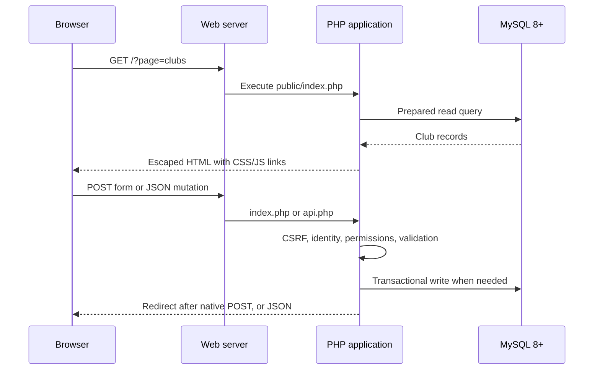

# Start here: remove the guesswork

[Learning home](README.md) · [Solo route](solo-path.md) · [Glossary](glossary.md)

This guide assumes you know some HTML/CSS/JavaScript, basic Git push and MySQL foundations. PHP, request flow and integration are taught from that starting point. Skim familiar topics, but still complete the explanation checkpoints.

## 1. Know what you are running

The browser does not execute PHP. A PHP web server executes `public/index.php`, which loads private application files, queries MySQL and returns HTML. The browser then interprets that HTML, loads CSS and runs JavaScript. A later `fetch()` request receives JSON from a second PHP entrypoint. Both entrypoints reuse the same domain actions.



There are three important kinds of state:

| State | Example | Where it belongs |
|---|---|---|
| Long-lived business data | Club, membership, booking | MySQL tables |
| Authentication/session state | Signed-in user ID, pending 2FA challenge, CSRF token | Private PHP session storage and session cookie |
| Harmless browser preference | Dark/light theme | Browser `localStorage` under `sportshub-backup-theme` |

Do not move authentication into localStorage to imitate a tutorial for a different stack. This application uses cookie sessions.

## 2. Establish one working local environment

Use **one** route first:

- **Native PHP + MySQL:** follow [the OS-specific setup](../docs/local-setup.md). Requirements include PHP 8.2+, `pdo_mysql`, `mbstring`, `sodium`, Argon2id and actual MySQL 8+. The default local URL is `http://localhost:8091`.
- **Docker:** follow the [root README's optional local recipe](../README.md#optional-docker-setup--isolated-local-development). Its example URL is `http://localhost:8095`; Docker Desktop/Engine must be running. Its helper files are local/ignored under `var/docker/` and are not a production deployment configuration.

The guides below assume native command examples unless stated otherwise. With Docker, PHP and the files are inside the app container: use the full Compose command from the README followed by `exec app php ...`. Host `php` is not required for that route. Do not start a second native server on top of the container to make the app work.

For a native environment already prepared according to the setup guide, this is the order, from the repository root:

```bash
php -v
php bin/setup.php
```

`php -v` checks which PHP your terminal uses. `bin/setup.php` creates `.env` with a generated key only when absent; it preserves an existing file. Create/configure the isolated MySQL database and account and edit the private `.env` as the setup guide explains **before** continuing:

```bash
php bin/migrate.php
php bin/doctor.php
php -S localhost:8091 -t public public/router.php
```

The migration creates/updates schema and writes data-definition state; it is not a read-only check. Doctor checks prerequisites and database tables. The last command stays running in that terminal until `Ctrl+C`; open the browser and use another terminal for other commands. PHP's built-in server is for local development.

If you already have a working local app, keep it. Do not regenerate its key, replace credentials or reset data merely to repeat a lesson. Provision a separate scratch environment for experiments that change relationships or schema.

## 3. Understand each secret's job

| Name | Meaning | Common mistake |
|---|---|---|
| `DB_PASSWORD` | Password of the MySQL application user named by `DB_USER` | Entering a website account password |
| Docker `DB_ROOT_PASSWORD` | Administrator password of that new MySQL container | Treating it as the website admin login |
| `APP_KEY` | Base64 encoding of a random 32-byte encryption key | Rotating it without migrating encrypted 2FA secrets |
| Website password | A human login secret stored only as a one-way Argon2id hash | Putting a plaintext password in SQL or Git |
| Authenticator setup key | Unique TOTP seed enrolled for one account | Sharing it as a group-wide login key |
| 2FA code | Short-lived code produced from that seed and time | Expecting a fixed code in documentation |
| Recovery code | One-use alternative factor, displayed once and stored hashed | Reusing it after successful consumption |
| CSRF token | Session-bound proof required for mutations | Treating it as an API bearer login token |

`.env` values in the native loader are literal `NAME=value` lines: no surrounding quotes or inline comments. Existing process variables take precedence. `APP_URL` must match scheme, hostname and port; `localhost` and `127.0.0.1` are different origins. Never send a private `.env` to diagnose a problem; share only sanitized variable names and error summaries.

## 4. First session: observe before changing

These are suggested sessions, not fixed deadline estimates. Stop at a checkpoint you can explain.

1. Open Home and Clubs. Identify the header, navigation, main content, repeated cards and footer.
2. In browser DevTools, use **Elements** to find the page's `<main>` and a club card. Change a color there temporarily. Reload and explain why the change disappears.
3. Use **Network**, reload and separate the initial HTML request from CSS/JavaScript/image requests. Read response headers without sharing cookie values.
4. Open [public/index.php](../public/index.php). Find `$pages`, `handle_action()`, `user()` and the layout include. They explain route selection, writes, current identity and rendering.
5. Open [app/layout.php](../app/layout.php) and [app/views.php](../app/views.php). Find how the selected page produces markup. Follow portal delegation into [app/portal-views.php](../app/portal-views.php) where relevant.
6. Open [app/bootstrap.php](../app/bootstrap.php). Find `db()`, `query()`, `e()` and `csrf_field()`. Read their explanations in Stage 04; you do not need to memorize implementation today.
7. Toggle dark/light and resize to a narrow phone width. In DevTools, find `data-theme` on the root element and the theme preference in storage. Do not inspect/copy private session files.
8. Record the request URL, source branch/helper and what you observed in [your log](learning-log.md).

**Checkpoint:** explain why opening a PHP file directly with `file://` cannot reproduce the app, why a DevTools style edit is temporary, and why hidden admin navigation does not secure a server action.

## 5. Trace your first complete business flow

Use separate browser profiles for two synthetic users or sign out between accounts. Two tabs in the same profile usually share the same session; port changes alone do not isolate cookies.

| Step | What you should observe | Where to look |
|---|---|---|
| Register student | Student role; no public role selector that creates an admin | Registration branch in [actions](../app/actions.php), `users` defaults |
| Log in | Session completes, or enrolled account requires a factor first | [security](../app/security.php), login/verify actions |
| Apply to a club | Membership becomes pending, private club access still denied | `reserve()` in [models](../app/models.php) |
| Admin approves | Pending status is reread, capacity checked, state changed | `review_request()` in [models](../app/models.php) |
| Student returns | Approved membership unlocks that exact club's private space | `club_access()` in [community](../app/community.php) |

Create the administrator with the private [CLI procedure](../docs/local-setup.md), or use optional **local-only random demo accounts** if already generated under the README procedure. No fixed shared administrator credentials are shipped. Account creation, club creation and approvals are writes; use synthetic records, not a live shared dataset for practice.

A fresh migrated database has no clubs. Before this journey, have the administrator create one fictional club with available capacity, or use the optional `php bin/seed.php` in **development mode only** following the setup guide. Keep existing wanted records; neither migration nor this lesson requires a database reset.

For the API path, read [docs/api.md](../docs/api.md): session bootstrap first, cookie plus fresh CSRF header for mutations, object-shaped JSON and exact Origin rules. For native forms, observe a POST followed by a 303 redirect when successful. JavaScript enhancement may instead show a JSON request and follow redirect metadata; both use shared server rules.

**Checkpoint:** draw the journey with browser → entrypoint → action/helper → table → response. Add the rule that blocks a pending member from private club content. This is the first thing to be able to demonstrate without notes.

## 6. When something fails

Use a narrowing sequence rather than editing everything:

1. **Can the server start?** Confirm the selected PHP executable or running Docker engine and free port.
2. **Can PHP connect?** Run doctor in the same environment as the app; check actual MySQL engine and schema.
3. **Does the URL reach the correct entrypoint?** Check `public/` document root, development router or Apache rewrite.
4. **What did the server return?** Check Network status and safe response; do not infer success from a button click.
5. **Which rule refused it?** Distinguish unauthenticated, forbidden, expired CSRF, validation, state conflict and DB outage.
6. **What changed?** Use `git diff` and private logs. Remove secrets before sharing evidence.

| Symptom | First explanation to investigate |
|---|---|
| Docker socket missing on macOS | Docker Desktop engine not running, or selected Docker context points elsewhere |
| PHP `could not find driver` | Selected PHP lacks `pdo_mysql` |
| Engine rejected | MariaDB or MySQL below 8; do not bypass the guard |
| Missing CSS/JSON routes | Wrong document root/router/rewrite |
| REST 403 / native 419 | Current session/CSRF and, for REST, exact Origin |
| Valid booking rejected | Future/time-length/overlap rules or changed state |
| Enrolled 2FA cannot decrypt | Dataset/key mismatch; do not randomly replace `APP_KEY` |

Use [the resource shelf](resources.md) for a specific question. Reading several complete courses before touching this project is unnecessary; learn the next missing concept and apply it.

## 7. Leave this introduction when you can

- [ ] Identify the canonical app root and the only public document root.
- [ ] Explain HTML/CSS/JS versus PHP/MySQL responsibilities.
- [ ] Start the chosen local environment without disturbing another project.
- [ ] Distinguish the database password, website password, app key and authenticator key.
- [ ] Trace one public page and the complete membership approval journey.
- [ ] Find the real server rule when the UI rejects or permits an action.
- [ ] Record an observation truthfully and name the next small task.

To mark a checklist in your own working copy, edit `[ ]` to `[x]` and save the Markdown file. A rendered GitHub checkbox may be read-only depending on the view and permissions. Checking a box records your understanding; it does not execute a test.
