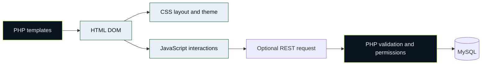

# 01 · Frontend and user experience

**Goal:** explain how SportsHub becomes a usable page, then improve one small component without breaking the working PHP/MySQL application.
This track covers semantic HTML, CSS layout, vanilla JavaScript, accessibility and the boundary between templates and server rules.
You do not need to understand every file before making a useful start.

[Learning home](../README.md) · [Shared first steps](../00-start-here.md) · [Solo route](../solo-path.md) · [Official resources](../resources.md)

## Your first session

Use an already configured local installation; [native setup](../../docs/local-setup.md) and the [repository README](../../README.md) explain starting it.
Use the exact browser address configured in `APP_URL`.
Start with public pages so you can inspect safely without creating users or changing data.

| Time suggestion | Do this | Save this small result |
|---|---|---|
| First 10 minutes | Open Home, inspect the main heading and one club card | The template path and three matching CSS selectors |
| Next 10 minutes | Change the viewport to 390px and back; toggle light/dark | Your prediction and an observed layout/theme change |
| Next 10 minutes | Tab through navigation, activate Skip to content and inspect its target | A short keyboard observation, with anything confusing marked honestly |
| Final 10 minutes | Read the card loop in `app/views.php`; explain `e()` | A five-sentence explanation in your own words |

These are suggestions, not a deadline or a claimed test run.
If setup is blocked, read the actual source and sketch the DOM first; mark browser observations **NOT RUN** until you can check them.
Do not spend the first session rebuilding the whole homepage.

## Read these four files in order

| Guide | Use it for |
|---|---|
| [Lessons](lessons.md) | Learn HTML → CSS → UI JavaScript → PHP templates → native forms → optional REST enhancement |
| [Source walkthrough](source-walkthrough.md) | Follow real excerpts through the actual layout, views, helpers and assets |
| [Exercises](exercises.md) | Practise with predictions, expected outcomes, hints, safe restoration and manual checks |
| This README | Pick the next small step and understand ownership/readiness |

The existing [build-order guide](../../docs/build-order-and-contributions.md) explains how this track joins the other three tracks.
The [source map](../source-map.md) helps when you meet an unfamiliar file.

## What is already here

SportsHub renders HTML in PHP; there is no production `home.html` to edit.
[public/index.php](../../public/index.php) selects a page, handles native POST actions and applies page access checks.
[app/layout.php](../../app/layout.php) emits the document shell; [app/views.php](../../app/views.php) and [app/portal-views.php](../../app/portal-views.php) emit page content.
[app.css](../../public/assets/app.css) supplies both themes and responsive layouts; [app.js](../../public/assets/app.js) adds browser interactions and REST form submission.
The application uses HTML, CSS, vanilla JavaScript, PHP and actual MySQL 8+ without a frontend framework or build dependency.

CSS and JavaScript can change what the browser shows.
They cannot grant administrator access, approve membership, prevent forged requests or make database writes safe by themselves.
The server remains responsible for those rules.

## Pair responsibilities: A and B

The [eight-member plan](../../docs/eight-member-plan.md) proposes A for semantic structure/shared PHP-rendered HTML and B for CSS, responsive themes and browser interactions.
A–G remain proposed slots until real people agree; H is the requester's chosen backend/API role.
Neither a role label nor studying a file establishes authorship of existing code.

| Change | Who needs to coordinate |
|---|---|
| A adjusts a heading, label, landmark or shared helper | B reviews visual/focus effects; C/E review affected student/admin branches |
| B adjusts a breakpoint, color token, menu or form interaction | A reviews semantics/keyboard behavior; C/E check their flows |
| Either changes a form name, hidden field, route or payload | The domain owner and G/H review server/API/data compatibility |
| Either touches `app/views.php` or `app/portal-views.php` | Agree the exact branch first; avoid formatting unrelated dense lines |

Keep one canonical runtime.
A tiny scratch experiment belongs outside `public/` and is not a second website to deploy.
If working alone, follow the same boundaries as a personal review checklist and use the [solo route](../solo-path.md) to connect layers gradually.

## Ready to continue when

- [ ] I can locate a rendered element in its actual PHP template.
- [ ] I can explain one winning CSS rule, one responsive change and one theme token.
- [ ] I can use keyboard navigation and describe what focus does.
- [ ] I can trace a named form field to native handling and optional Fetch submission.
- [ ] I can say which checks belong to PHP rather than JavaScript.
- [ ] My proposed patch, observations and explanation reflect work I actually did.

Source inspected for this package: `f455575` on 4 November 2026, Asia/Colombo.
This is educational documentation, not evidence that the learner ran the app, completed a contribution or deployed a host.
Record actual checks in your own evidence and compare with the [learning validation record](../validation.md).
