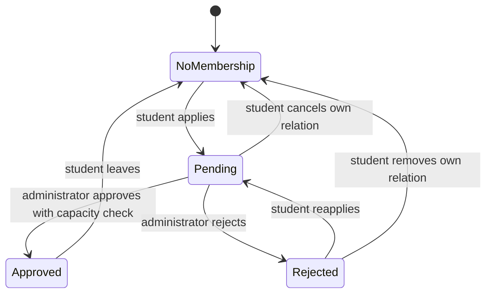

# Lessons · fields become requests, relationships and state

[Stage dashboard](README.md) · [Source walkthrough](source-walkthrough.md) · [Practice](exercises.md)

These lessons describe the current PHP/MySQL implementation. A proposed improvement is not an existing
feature, and a predicted result is not a completed test. Keep a worksheet with **prediction → observation
→ source explanation**, using synthetic local records only.

## 1. Forms read state or request a change

A form control's `name` is the key submitted to the server. Its label is the human-readable explanation;
changing a label need not change the key. Changing the key can break PHP/API validation.

| Actual interface | Form fields | Transport and meaning |
|---|---|---|
| Club filter | `page=clubs`, `q`, `sport` | GET: choose which club rows to display |
| Apply | `action=join`, `id`, `csrf` | Native POST: request a membership change |
| Registration | `action=register`, `name`, `student_id`, `faculty`, `email`, `password`, `csrf` | Native POST or enhanced JSON creation |
| Booking | `action=book`, `resource_id`, `starts_at`, `ends_at`, `purpose`, `csrf` | Request a particular resource/time interval |

GET filters remain in the query string, so links can express a search. POST fields do not belong in a
shareable search URL. That is especially important for credentials and factors. The app uses the same
HTML form as a native fallback and a JavaScript-enhanced REST request, with different wire formats.

JavaScript calls `preventDefault()` only for a recognized action, maps it to a method/path, and sends JSON.
It strips `action`, `csrf`, `id` and `entity` from that JSON because routing/token transport now carries
their meaning. Community routing IDs are stripped too. Server-side route parsing fixes the target IDs.
Cookies carry session identity; a client-provided user ID must not become the authority.

A native success redirects with HTTP **303**, then the next page request is GET. REST returns JSON,
including a message/redirect where applicable; the browser enhancement follows it. They share the PHP
service result, not an identical response body. Read [MDN's form submission explanation](https://developer.mozilla.org/en-US/docs/Learn_web_development/Extensions/Forms/Sending_and_retrieving_form_data)
when you need the browser vocabulary, then identify the same names in SportsHub.

## 2. Account screens are not security decisions

[The account branch](../../app/views.php) changes markup for login/register/verify. Registration gathers
name, student ID, faculty, email and password; verification gathers `code`, not a new password. The UI
faculty options are Computing/Business/Engineering/Science, while the current backend accepts bounded
nonempty faculty text. Do not describe that select as a server-enforced faculty enum.

The actual registration action lowercases email, validates email/student-ID syntax, checks uniqueness,
limits password to **12–128 bytes** using `strlen`, hashes it with Argon2id and inserts a student.
The message says characters, but bytes and characters differ for multibyte input. HTML length attributes
improve feedback; they do not replace the server's check. Role is not a registration field.

| Student-visible state | What is actually true | C/D responsibility and H boundary |
|---|---|---|
| Account created | A student row exists; sign-in is still required | Explain the next step; do not promise auto-login |
| Password accepted without 2FA | `finish_login()` completes/rotates session | Correct destination/feedback; H owns identity state |
| Password accepted with 2FA | Five-minute pending challenge, no authenticated portal access | Route to verify; never bypass the challenge |
| Authenticator/recovery accepted | Second-factor service completes login | Explain freshness/recovery safely; H owns proof/replay checks |
| Invalid/expired proof | Access refused or sign-in required again | Surface useful error without exposing factor values |

[app/security.php](../../app/security.php), bootstrap and auth branches belong to H's security review.
C/D should understand how the screens call them without replacing cryptography or inventing a password
reset route. Passwords, cookies, setup keys and recovery codes never belong in localStorage or evidence.
For definitions, use [PHP password hashing](https://www.php.net/manual/en/function.password-hash.php)
and [MDN cookies](https://developer.mozilla.org/en-US/docs/Web/HTTP/Guides/Cookies), then follow the actual code.

## 3. Membership is a relationship with a decision

One student can join several clubs, and one club can receive many students. `memberships` joins users
to clubs and adds status. A unique `(user_id, club_id)` pair prevents a second relation for the same pair.
The club's capacity counts **approved** members, not every pending application.

`reserve('memberships', ...)` locks the club, checks existing status and capacity, then inserts pending
or updates a rejected relation back to pending. Applying again while pending/approved is refused.
Reapply reuses the unique relation; it does not create duplicate membership history. Own cancellation
removes the row rather than retaining a cancelled membership status. These are real model choices,
not rules to infer from button colors.

Discovery at `?page=clubs` is public. Opening `?page=club&club_id=...` requires login even for Overview.
Community/Members/club Schedule need an administrator or approved membership in that **exact** club.
A pending HTML visitor sees a friendly gate, often with HTTP 200; the private API denies access 403.
Different presentation is not a privacy bypass. Club overview/summary is different from private bodies.
The HTML club search matches name or sport; the current JSON collection applies `q` to name. Read/filter
contracts are not automatically identical just because the two mutation transports share services.

C/D must coordinate approval changes with E/F and table/locking changes with G/H. A student should never
approve their own application by changing a hidden field. The authoritative decision is checked in PHP,
then stored in MySQL, and rechecked on later private requests.

## 4. An entry is not the same as attendance

| Relation | Parent | Meaning | Main registration rule |
|---|---|---|---|
| `memberships` | Club | Request/approved connection to a club | Capacity, one relation per student/club |
| `registrations` | Tournament | Individual competition enrollment | Open status, deadline, capacity and no duplicate |
| `attendance` | Event | Registered or recorded attended session/match | Eligible time, approved exact-club membership, no duplicate |

The schedule combines training and matches stored in `events`. Future event controls request `attend`;
that action inserts an attendance row with `registered`, not `attended`. An administrator records
attendance only after the event starts. The report view may show a Mark attended control for a future
registered row, but the server still refuses it; button visibility is not proof of eligibility.

Tournament entry calls `reserve('registrations')`, whose current guards do **not** require club membership.
Entering a tournament does not register the student into each fixture. Fixtures may reference a
tournament, but the two relations and commands remain independent. A team-entry engine and automatic
bracket progression are not implemented.

`?page=activity` joins each of the student's four relation types to its parent label/time. The dashboard
shows limited previews; its “Session registrations” count includes both registered and attended rows.
Results come from scored match events. The displayed standings use club wins 3 / draws 1 / losses 0 points;
they are not sport-specific rules or a complete tournament bracket.

Future eligible event/tournament registrations may be cancelled by their owner. Started tournaments
and attended/started events are protected against own cancellation. Read the actual time comparisons
in [actions](../../app/actions.php) and [models](../../app/models.php), rather than guessing from a date badge.

## 5. Booking is an interval and a resource

A booking supplies `resource_id`, `starts_at`, `ends_at` and `purpose`. Time inputs use minute precision
`YYYY-MM-DDTHH:MM` with no offset. PHP uses Asia/Colombo and SQL connection timezone is +05:30; the app
interprets these inputs as local Sri Lanka time, not automatically as the browser's UTC conversion.

The service requires a future start, end after start and duration at most four hours. It locks the
resource before checking/inserting, using READ COMMITTED for the transaction. Pending **and** approved
reservations block another interval on the same resource. A resource represents a single reservable
unit; there is no quantity-based equipment inventory calculation.

**Overlap condition:** existing start is before requested end **and** existing end is after requested
start. Both strict comparisons must hold. On the same future day and otherwise free resource:

| Existing interval | Requested interval | Prediction |
|---|---|---|
| 10:00–11:00 | 10:30–11:30 | Overlap; reject |
| 10:00–11:00 | 11:00–12:00 | Adjacent; permit if other rules hold |
| 10:00–11:00 | 09:00–12:00 | Contains existing interval; reject |
| Resource A, 10:00–11:00 | Resource B, 10:00–11:00 | Separate resources; A alone does not block B |

Do not test these examples on today's already-past times or a resource with other wanted bookings.
Admin review also checks current pending state and collisions under locks. A request is pending,
not automatically approved. A future pending/approved booking may be cancelled by its owner; this
**updates status to cancelled**, retaining the history. Rejected/cancelled bookings do not block slots.
Repeated cancellation is a conflict, not a second success. Another user's booking is not yours to edit.

MySQL's [locking-read documentation](https://dev.mysql.com/doc/refman/8.4/en/innodb-locking-reads.html)
explains why an unlocked “check then insert” is insufficient under concurrent users. G/H/F review
transaction changes; a UI label patch should not casually change the lock order or isolation level.

## 6. Community access is scoped to one club

`club_access(clubId)` checks login, existence and exact approved membership or admin role on each service
request. Merely belonging to some other club or having once loaded a page is insufficient. Leaving
revokes subsequent access; previously rendered text may remain in browser memory until reload.

| Action/state | Current behavior |
|---|---|
| Post/comment | Required plain text, bounded length and throttled; escaped for HTML output |
| Edit | Author only; admin may moderate/delete but cannot edit another person's words |
| Reaction | One per member/post; repeated PUT is idempotent |
| Report | One private reason per member/post; duplicate report 409 |
| Hide | Administrator retains content for review; private member reads no longer show it |
| Edit hidden text | Author service/API can correct body; visibility remains hidden |
| Restore | Administrator decision with reason, resolving reports and auditing |
| Delete | Own author/admin erases body and dependent comments/reactions/reports; retained tombstone cannot restore |

Hidden posts are absent from the HTML feed, so that screen does not offer an edit form for them.
Service permission to edit hidden text is not a claim the feed includes a hidden-content editor.
Report reasons/moderation details are admin-private. Member roster exposes names/faculty and API join
metadata, not email/student ID/auth fields. HTML caps are 10 posts/page, latest 20 comments/post,100 members;
API pagination can access larger permitted collections. Counts and previews are not complete exports.

Continue with [the concrete source traces](source-walkthrough.md). Keep [MDN Fetch](https://developer.mozilla.org/en-US/docs/Web/API/Fetch_API/Using_Fetch)
for HTTP/JSON vocabulary and [official resources](../resources.md) for the larger curriculum.
