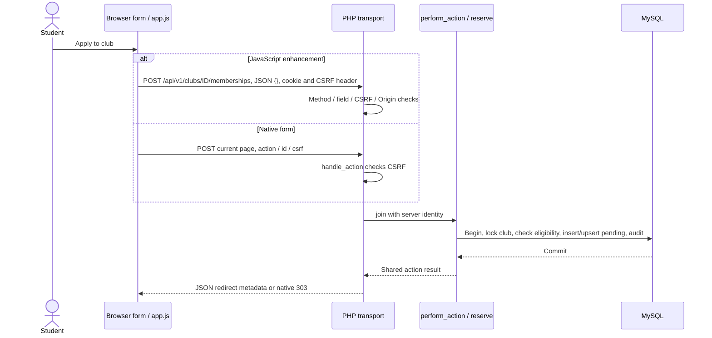

# Source walkthrough · follow one request completely

[Stage dashboard](README.md) · [Lessons](lessons.md) · [Exercises](exercises.md)

Inspected source baseline: `f45557509e0202d4c93411db3a1237f44d9082ae` on `main` before this guide was added.
Excerpts below are short selected fragments of those real files, not replacement modules or standalone
programs. A SQL `?` is a prepared-statement placeholder; do not paste it into a production SQL console.
A real source link is more useful than copying an entire file into a learning directory.

## 1. Find the page before tracing a write

[public/index.php](../../public/index.php) allowlists page names, handles native POST and checks roles.
It then renders [layout](../../app/layout.php), whose page content comes from
[views](../../app/views.php). The first branch there delegates dashboard/admin/my_clubs/club/moderation/audit
into [portal-views](../../app/portal-views.php). This is server rendering, not a client-side page framework.

| Page branch | Data/read or UI contract to inspect | Boundary |
|---|---|---|
| `register/login/verify` | `action` plus the page's actual field names | H validates identity/factors; C explains feedback |
| `clubs` | GET `q/sport`, bound LIKE values, approved-member count | Discovery public; club detail requires login |
| `dashboard/my_clubs` | Own metrics and recent relation rows | `current.id` scopes personal data |
| `club` | `club_id`, selected tab, membership gate and feed | Private tabs after approved exact-club check |
| `schedule/tournaments` | Filtered event/tournament lists and action forms | Each enrollment calls a different reserve branch |
| `facilities` | Resource/date/purpose POST fields | Service validates interval and locks resource |
| `activity` | Four own-user JOIN queries and eligible Cancel controls | Service checks ownership/time again |
| `security` | Enrollment/disable input and one-time display | No factor screenshots; H owns implementation |

An important order: native POST is dispatched before page rendering. The POST form is not a SQL write
merely because it lives under a particular page; the server's action dispatcher decides its behavior.

## 2. One Apply button, two transports

Actual fragment from [app/views.php](../../app/views.php); surrounding context stays in that source file.

```php
action_button('join',(int)$c['id'],'Apply to join →');
```

`action_button()` emits `<form method="post">`, a CSRF hidden field, `action=join`, the club's `id`,
optional extra fields and a button. `id` here means **club ID**, not membership ID. Existing HTML cards
may offer Apply even if a request already exists; the server still refuses duplicate pending/approved.

Actual fragment from [public/assets/app.js](../../public/assets/app.js); surrounding context stays in that source file.

```javascript
    join: ["POST", `/clubs/${fields.id}/memberships`],
    register_tournament: ["POST", `/tournaments/${fields.id}/registrations`],
    attend: ["POST", `/events/${fields.id}/attendance`],
```

This JavaScript object maps action names to `[method,path]` arrays. Template strings place the form's ID
into the URL. `endpoint()` returns one pair; the submit handler destructures it, strips route-only
fields, captures the token and sends the remaining object. Membership's JSON body is `{}`.

Actual fragment from [public/assets/app.js](../../public/assets/app.js); surrounding context stays in that source file.

```javascript
      const response = await fetch("/api/v1" + path, {
        method,
        credentials: "same-origin",
        headers: {
          "Content-Type": "application/json",
          Accept: "application/json",
          "X-CSRF-Token": token,
        },
        body: JSON.stringify(fields),
      });
```

`await` waits for a response; `JSON.stringify` serializes fields. `credentials` keeps same-origin session
cookies. The token is sent in a header, not left in the mutation JSON. The handler updates hidden CSRF
values from returned metadata after rotation, displays a safe error or follows an allowed redirect.
A network failure shows an outcome-unknown message and does not automatically replay the write.

With JavaScript disabled, there is no fetch conversion; the normal POST includes action/id/csrf.

Actual fragment from [app/actions.php](../../app/actions.php); surrounding context stays in that source file.

```php
function handle_action(): never {
 check_csrf();
 $result=perform_action((string)($_POST['action']??''));
 if ($result['message']!=='') flash($result['message']);
 go($result['redirect']);
}
```

`check_csrf()` precedes the service. `(string)` and `??''` select an action string/default, not permission.
`perform_action()` returns redirect/message/data. `flash()` saves the notice in session; `go()` issues 303
and exits. For JSON, [public/api.php](../../public/api.php) instead calls `api_dispatch()` and catches
errors into the envelope. Its method/role/CSRF/Origin/content/field checks precede the shared action.

Actual fragment from [app/api.php](../../app/api.php); surrounding context stays in that source file.

```php
  api_fields($payload,[]); $_POST=['id'=>$m[2]]; $result=perform_action($actions[$m[1]]);
```

In this enrollment route, `$m` is the regex's fixed URL match. Empty allowed fields mean client JSON
cannot add another user/record selector. PHP fixes `id` from the URL, then maps clubs→join,
tournaments→register_tournament, events→attend. `perform_action()` calls `require_user()` and `reserve()`
with authenticated user ID. It does not accept an arbitrary submitted `user_id`.



Success means a **pending request**, not approved access. Use the response/row to name the state honestly.

## 3. Read the membership write and its constraints

Actual fragment from [app/models.php](../../app/models.php); surrounding context stays in that source file.

```php
   $c=one('SELECT * FROM clubs WHERE id=? FOR UPDATE',[$id]); if (!$c) throw new DomainException('Club not found.');
   $existing=one('SELECT * FROM memberships WHERE club_id=? AND user_id=?',[$id,$uid]);
   if ($existing && $existing['status']!=='rejected') throw new DomainException('You already have a membership request.');
```

1. `one()` returns one associative row or null. The query binds club ID and locks it with FOR UPDATE.
2. The next read matches both club and current user, so approval in another club cannot stand in.
3. Existing pending/approved is refused. A rejected row is allowed to proceed.
4. The following source statement counts approved members against the club's capacity before writing.

Actual fragment from [app/models.php](../../app/models.php); surrounding context stays in that source file.

```php
   query("INSERT INTO memberships(user_id,club_id) VALUES(?,?) ON DUPLICATE KEY UPDATE status='pending'",[$uid,$id]);
```

The two `?` parameters receive user then club, in that order. With no relation, default status is pending.
With the unique pair already present after rejection, the UPDATE path sets pending instead of creating
another relation. MySQL's [upsert reference](https://dev.mysql.com/doc/refman/8.4/en/insert-on-duplicate.html)
explains this syntax; inspect the matching index before generalizing the behavior to other tables.

Actual fragment from [database/schema.sql](../../database/schema.sql); surrounding context stays in that source file.

```sql
 UNIQUE(user_id,club_id), FOREIGN KEY(user_id) REFERENCES users(id) ON DELETE CASCADE,
 FOREIGN KEY(club_id) REFERENCES clubs(id) ON DELETE CASCADE
```

The unique pair and foreign keys live in `memberships`, not in the CSS badge. Foreign keys require real
parent rows; cascades mean deleting users/clubs may remove relations. An admin approval is the separate
`review_request()` path: parent then request lock, pending reread, capacity recheck, UPDATE, audit, commit.
C/D must review its visible effect with E/F and concurrency/data details with G/H.

Actual fragment from [app/portal-views.php](../../app/portal-views.php); surrounding context stays in that source file.

```php
$allowed=$isAdmin || ($membership && $membership['status']==='approved');
```

This fragment is the club HTML condition. `$membership` must exist and be approved, unless admin.
The overview precedes the private-tab gate. Feed/member/schedule branches follow it; invalid tab values
fall back to overview. This condition is presentation-side protection within PHP, not the only guard.

## 4. Trace booking validation and interval binding

Actual fragment from [app/actions.php](../../app/actions.php); surrounding context stays in that source file.

```php
  $resource=positive('resource_id'); $start=date_input('starts_at'); $end=date_input('ends_at'); $purpose=text('purpose',255);
  if (strtotime($start)<=time() || $end<=$start || strtotime($end)-strtotime($start)>4*3600) throw new DomainException('Choose a future booking of up to four hours.');
```

`positive()` validates resource ID, `date_input()` parses exact minute format into SQL datetime, and
`text()` trims/requires/bounds purpose. `strtotime()` compares local timestamps. The three disallowed
cases are nonfuture start, end not after start, or duration greater than four hours. Do not remove them just
because the HTML date widget permits a value.

The next source lines start READ COMMITTED, begin a transaction and lock the selected resource row.
Only then does the following collision test run:

Actual fragment from [app/actions.php](../../app/actions.php); surrounding context stays in that source file.

```php
   if (one("SELECT id FROM bookings WHERE resource_id=? AND status IN ('pending','approved') AND starts_at<? AND ends_at>?",[$resource,$end,$start])) throw new DomainException('This time slot is unavailable.');
```

Bind order is **resource, requested end, requested start**. Read it literally: existing starts before
our end AND existing ends after our start. Swapping those arguments breaks the interval test. A found
row throws, rolling back; otherwise INSERT stores current user/resource/time/purpose as pending and
commits with audit. F's admin review is a later command, not part of successful booking creation.

## 5. Private community checks survive a stale page

Actual fragment from [app/community.php](../../app/community.php); surrounding context stays in that source file.

```php
 $u ??= require_user();
 $club=one('SELECT * FROM clubs WHERE id=?',[$clubId]);
 if (!$club) throw new RequestError(404,'Club not found.');
 if ($u['role']!=='admin' && !one('SELECT id FROM memberships WHERE club_id=? AND user_id=? AND status="approved"',[$clubId,$u['id']])) throw new RequestError(403,'An approved club membership is required for this community.');
```

`??=` fills a missing user argument from the authenticated session. Missing club gives 404. The `&&`
requires both non-admin and absent exact approved relation before throwing 403. This check executes
for member service/API requests, even after the page was rendered earlier.

`community_action()` starts READ COMMITTED and wraps a member mutation in a transaction. For an existing
post, `community_post()` matches post **and club**, rejects deleted/unavailable content and may lock the
parent. That lock serializes a dependent comment/edit/reaction against moderation/deletion decisions.

Actual fragment from [app/community.php](../../app/community.php); surrounding context stays in that source file.

```php
   query('UPDATE club_posts SET body=? WHERE id=?',[$body,$id]);
```

This edit statement changes only body. The surrounding branch checks author identity and permits the
hidden-edit path; status remains hidden until an admin decision. An administrator cannot edit another
author's words, though admin may delete/moderate. Hidden content remains absent from ordinary reads.
Deletion is different SQL: erase body, mark deleted, clear reason and remove child content; no restore.

The community API allows `body` or `reason` as appropriate, fixes route IDs and returns safe member fields.
Private moderation reports use admin routes. The HTML feed escapes post/comment bodies; validators only
bound plain text and cannot replace output escaping. A hidden post's correctable API state does not mean
its form is present in the visible feed.

## 6. History and cancellation are scoped to the current account

Actual fragment from [app/views.php](../../app/views.php); surrounding context stays in that source file.

```sql
SELECT a.*,e.title label,e.starts_at FROM attendance a JOIN events e ON e.id=a.event_id WHERE a.user_id=?
```

This literal query is inside the activity section map. `a.*` selects the relation, `e.title label`
adds a readable title, and JOIN follows event_id. The placeholder receives `current.id`. A missing WHERE
would expose someone else's participation; a safe card label must not lead to weakening the query.

Actual fragment from [app/actions.php](../../app/actions.php); surrounding context stays in that source file.

```php
   query("UPDATE bookings SET status='cancelled' WHERE id=? AND user_id=?",[$id,$u['id']]);
```

Before this statement, the service loads the record with both ID and user ID, then checks future time
and pending/approved booking status. The UPDATE keeps the user condition as well. A different owner
returns 404; an ineligible/repeated cancellation returns 409. Other relation cancellations use DELETE,
with extra time/status checks for tournament/event entries. Membership has no cancelled status to show.

The [existing HTTP suite](../../tests/integration.php) contains own-history, duplicate enrollment,
community gate/hidden-edit, interval and cross-owner cancellation assertions. The
[concurrency suite](../../tests/concurrency.php) verifies specific approval contention. Reading their
assertions is not running them; their reset target must be proven disposable before future execution.

## 7. Debug the correct layer

| Observation | First question | Safe inspection |
|---|---|---|
| No request | Is form/action recognized or native? | Form names and endpoint map |
|303 | Was this native success/redirect? | Location/page state, not a presumed JSON response |
|401 | Is full authentication established? | Login/challenge state, never dump session values |
|403 | Role/club, CSRF or Origin? | Safe message and exact configured origin |
|419 | Native form token expired/missing? | Reload, inspect current state, submit once |
|422 | Which validation/domain rule refused? | Input type/time/eligibility and service branch |
|404 | Missing/not-owned/hidden post or route issue? | IDs and route family without revealing private data |
| Network error | Could the write have committed? | Read current activity before retrying |

Do not log passwords, cookies, tokens, factor values, full user rows or private report reasons.
Continue to [exercises](exercises.md); use [MDN Fetch errors](https://developer.mozilla.org/en-US/docs/Web/API/Fetch_API/Using_Fetch)
and the [PHP PDO manual](https://www.php.net/manual/en/book.pdo.php) to clarify APIs, then return to source.
