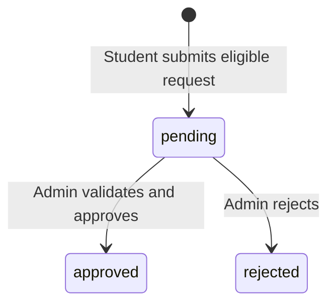

# Lessons · Make an administrative decision safe

[Stage dashboard](README.md) → [Source walkthrough](source-walkthrough.md) → [Exercises](exercises.md)

## 1. Begin with a decision, not a dashboard

A dashboard organizes work. It does not give a browser permission to change data. A student can construct the same URL or HTTP request as an administrator, so a missing sidebar link is never the security boundary.

**Authentication** establishes which account is signed in. **Authorization** decides whether that account may perform this operation. **Validation** checks the submitted values and current business state. **CSRF protection** rejects a forged mutation that lacks the session's unpredictable token. These checks solve different problems.

| Browser situation | Server must decide | Actual location |
|---|---|---|
| Guest opens admin page | Require a signed-in administrator | `public/index.php` → `require_admin()` |
| Student guesses admin API | Reject wrong role | `app/api.php` before an `admin/` dispatch |
| Student forges native Save | Reject before a core admin write | `perform_action()` → `require_admin()` |
| Admin submits stale approval | Reread state and capacity/overlap | `review_request()` |
| Admin submits moderation | Check role inside early-dispatched service | `moderate_post()` |

The administrator role is stored in `users.role`. A hidden field saying `role=admin` cannot grant it. Public registration creates a student; administrator provisioning is a private CLI operation.

Read [OWASP's authorization guidance](https://cheatsheetseries.owasp.org/cheatsheets/Authorization_Cheat_Sheet.html), then point to one concrete server guard here. Naming a principle without finding its implementation is not yet understanding it.

## 2. Read, create, update, delete: four different intentions

CRUD means **Create, Read, Update, Delete**. Read first: it tells you which row exists and what relationships it has. Delete last: its effects can extend far beyond the visible card.

The application uses one metadata-driven management form for four entity types. `entities()` returns a fixed map of table names, labels and fields. It is an allowlist, not a mechanism for accepting arbitrary SQL table names from the browser.

| Entity key | UI route | Purpose |
|---|---|---|
| `clubs` | `/?page=manage_clubs` | Sporting community, coach, location and capacity |
| `tournaments` | `/?page=manage_tournaments` | Competition dates, deadline, roster capacity and status |
| `events` | `/?page=manage_events` | Club training or match fixture, optional tournament and scores |
| `resources` | `/?page=manage_resources` | One reservable facility/equipment unit |

A GET edit link reads a row; it must not save or delete it. Native POST forms carry `action`, `entity`, `id`, CSRF and fields. The REST adapter uses POST for create, PUT for full replacement and DELETE for deletion.

PUT is not a one-field score patch here. `save_entity()` validates the full descriptor, so missing required fields fail even if the one supplied field is valid.

## 3. Validate exactly what the code accepts

The browser's `required`, input type and maxlength improve usability. The server still checks everything, because a custom HTTP client can bypass HTML constraints.

| Entity | Actual input names | Important server rules |
|---|---|---|
| Clubs | `name,sport,description,coach,location,capacity` | Required text; positive capacity at most 10000 |
| Tournaments | `name,sport,description,location,starts_at,ends_at,registration_deadline,capacity,status` | End after start; deadline not later than start; status open/ongoing/completed |
| Events | `title,club_id,tournament_id,kind,location,starts_at,ends_at,opponent,home_score,away_score` | Existing club, optional existing tournament, training/match, valid interval and score rules |
| Resources | `name,kind,description,location` | Kind facility/equipment; required descriptive text |

The text validator trims values and measures characters with `mb_strlen()`. Description is limited to 5000; sport to 60; `name` to 120; ordinary remaining fields such as title, coach and location to 100. Optional opponent is limited to 120. These are PHP limits, sometimes narrower than the SQL column width.

Datetime input must round-trip exactly as `YYYY-MM-DDTHH:MM`; impossible normalized dates are rejected. PHP and the SQL session use Sri Lanka time. Do not compare a local datetime as though it contained a UTC offset.

One subtle source fact: registration deadline equality with tournament start is accepted because the check rejects `deadline > start`. Its error message says “before”; teach the actual comparison rather than inventing a stricter rule.

Other limits remain: saving a lower capacity does not enforce “at least the current enrollment count”; linked fixtures are not validated to match tournament sport or date range. These are potential reviewed improvements, not implemented safeguards.

## 4. Prepared values and trusted identifiers

Prepared statements separate SQL syntax from submitted values. A quote in a club name stays data. A placeholder binds a value, not a table name or column list.

The model constructs identifiers from `entities()` and binds values with `?`. Removing the fixed descriptor and interpolating a submitted table name would destroy that boundary even if other values remained prepared.

[PHP's PDO prepared-statement manual](https://www.php.net/manual/en/pdo.prepared-statements.php) explains this distinction. HTML escaping is separate: `e()` uses `htmlspecialchars()` when rendering text, so a stored title cannot become an HTML tag. It is not SQL escaping.

## 5. Save and audit together

An **audit record** states who performed an operation, its action name, a bounded detail and time. It helps explain changes. It is not a cryptographically tamper-proof log or proof of original code authorship.

`save_entity()` validates first, starts a transaction, creates/updates the entity, writes `save_<entity>`, then commits. Updating locks the selected row. The delete action similarly locks the existing record, deletes it and writes `delete_<entity>` before commit.

A transaction makes these grouped writes **atomic**: commit publishes them together; an exception rolls back their uncommitted changes. Do not generalize this to every action. The attendance action's UPDATE and audit are not wrapped in an explicit encompassing transaction in the current code.

MySQL schema DDL can implicitly commit. A data rollback is not a way to undo arbitrary applied migrations. New schema changes require reviewed additive migration and backup/recovery planning.

## 6. Approval is a state transition

A membership joins a user to a club. A booking joins a user to a resource and time interval. Both begin pending. The current admin review service accepts only `approved` or `rejected`, and only while the request remains pending.



This is the **review subflow**, not a complete cancellation state machine. Memberships can later be left, rejected memberships can reapply, and eligible bookings can become cancelled through their owner's separate action.

The Approvals page selects pending rows only. After approval a row disappears from that queue because its status changed, not because it was deleted. The REST list additionally supports a status filter.

## 7. Why a lock and READ COMMITTED both matter

Imagine one place remains in a club and two different requests are pending. If both reviewers count the available place before either saves, both could approve. A UI disabled button does nothing to coordinate separate requests or administrators.

The shared club row is a **parent**: all memberships refer to it. Locking it with `SELECT ... FOR UPDATE` provides one coordination point even before a new child membership exists. Bookings similarly coordinate through their resource row.

`review_request()` explicitly requests READ COMMITTED before beginning its transaction. A later nonlocking read can see a decision committed while this transaction waited. Parent locking and read visibility are related but distinct tools.

Actual review order:

1. Validate entity/status and request a READ COMMITTED transaction.
2. Read the pending candidate to discover its parent.
3. Lock that club or resource parent.
4. Lock and reread the request; require it still pending and associated with the same parent.
5. Check approved membership count or approved booking overlap.
6. Update status, write audit and commit; roll back on any failure.

The second request read handles a reviewer who changed the same request while this one waited. The fresh count handles competing different requests for the same parent. Consistent parent-before-child lock order also reduces inconsistent lock ordering between these services.

The [MySQL locking-read guide](https://dev.mysql.com/doc/refman/8.4/en/innodb-locking-reads.html) and [isolation-level guide](https://dev.mysql.com/doc/refman/8.4/en/innodb-transaction-isolation-levels.html) explain the engine concepts. Existing concurrency regressions exercise two concrete approval cases; they are not proof against every possible concurrent edit.

## 8. Booking intervals: adjacent is not overlapping

The request action validates a future interval with end after start and duration no longer than four hours. Pending **and** approved bookings block a new request. Review rechecks overlaps against other approved reservations under the same resource lock.

```text
Existing:    [16:00 -------- 17:00)
Conflicting:       [16:30 -------- 17:30)
Adjacent:                    [17:00 -------- 18:00)
```

The condition is `existing.start < requested.end AND existing.end > requested.start`. Both strict comparisons must be true. With touching endpoints the second comparison is false, so adjacency is allowed.

The index helps find candidate rows; it does not itself prohibit overlap. A unique `(resource_id, starts_at)` key would still miss overlaps with different start times. The business check and shared parent-lock protocol enforce the intended interval invariant.

Each resource row is one reservable unit. Do not promise equipment quantity accounting; that would require additional design.

## 9. Fixtures, tournament entries and results are different records

A tournament is a competition with a roster. An event is a club training session or match, optionally linked to a tournament. Registering for a tournament creates `registrations`; joining a specific event creates `attendance`. One does not automatically populate the other.

Scores live on an event. Both scores may be blank, or both must be integers from 0 through 100000. If scores exist, `kind` must be `match` and opponent must be nonempty. Zero is a score; NULL is a missing score.

| Submitted state | Result |
|---|---|
| Both scores missing | Unscored event |
| Home 0, away missing | Rejected pairing |
| Home 0, away 0, match and opponent present | Recorded draw |
| Two scores on training event | Rejected |

Results selects recorded matches. Standings derive club played/wins/draws/losses and points: win 3, draw 1, loss 0. Opponent is free text, not a second club relation; the application does not automatically create an opponent's mirrored statistics.

Generic club standings are not a bracket generator, automated team assignment or sport-specific ranking/tie-break system. Scores may be entered before event start; no completed-event guard exists in save validation.

## 10. Registration is not attendance

Event registration creates an `attendance` row with status registered. An administrator can mark it attended only once its event has started. The service rejects a missing row or future start even if the browser displays a Mark attended control.

The current report UI offers that control for any registered row, including a future one. Clear availability feedback is a proposed learner task. Keep the server guard even if a UI patch hides or disables the control.

A repeated attended action can update the same state and add another audit record. There is no absent enum or attendance-reversal interface here. Do not invent those states in a demonstration.

## 11. Reports: calculate what the label means

| Report measure | Actual count | Do not claim |
|---|---|---|
| Approved members | Approved membership rows for a club | Every applicant or all accounts |
| Session registrations | Attendance rows linked to that club's events, including attended rows | Unique athletes across sessions |
| Attended | Subset with status attended | Automatic presence detection |
| Tournament participants | Registrations joined to user/tournament | Team allocation or fixture attendance |

One student registered for three sessions contributes three registration rows. If two are attended, the attended total is two. Use synthetic rows to verify your interpretation before relabeling a statistic.

Independent subqueries per club avoid multiplying counts by joining several one-to-many relations together. The rendered report includes a roster and recent audit entries; the JSON report has clubs, tournament counts and booking counts by status. It is not an identical representation.

Print/save PDF uses the browser's print function and print CSS, not a backend PDF-generation library. HTML admin lists are mostly unpaginated; the moderation page shows 20 posts, audit page latest 100 and report audit latest 50. API collections support pagination where documented.

## 12. Moderate privately; distinguish hide from delete

A member can submit one private report per post. Administrators see report reasons/reporters; member feed projections must not receive those private fields.

`moderate_post()` accepts visible/hidden and a required reason of 1–500 trimmed characters. It locks a nondeleted post, changes status/reason, resolves its reports and writes an audit decision in one transaction.

Hide retains text and children for review. Restore makes a hidden post visible. Editing a hidden post as its author changes its body but never restores visibility. Administrators may delete others' posts/comments but cannot edit another author's post.

Post deletion is different: the service empties body/reason, retains a deleted tombstone and removes comments/reactions/reports. Deleted content cannot be restored by moderation. A foreign key alone cannot enforce that rule because the tombstone row still exists; the service checks its status under lock.

## 13. Delete follows relationships, not screen boundaries

| Parent deleted | Actual relationship effects |
|---|---|
| Club | Memberships, events and community posts cascade; event attendance and post children cascade transitively |
| Tournament | Registrations cascade; related events keep existing identity but tournament_id becomes NULL |
| Event | Attendance cascades |
| Resource | Bookings cascade |

A committed delete is not reversible merely because the browser had a confirmation. Client confirmation is usability; a forged request can bypass it. Authorization, CSRF, existence checks and SQL foreign keys remain authoritative.

Read [MySQL's foreign-key documentation](https://dev.mysql.com/doc/refman/8.4/en/create-table-foreign-keys.html). Plan any future archive/retention feature explicitly with G and affected owners instead of pretending the current Delete is an archive.

Continue to [Source walkthrough](source-walkthrough.md), then predict the outcomes in [Exercises](exercises.md) before reading its hints.
