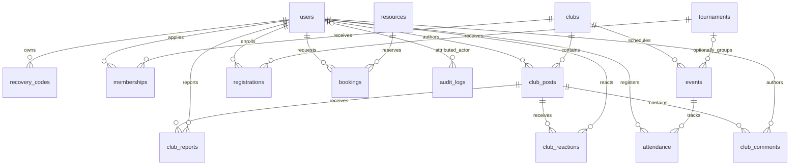

# Data dictionary · the real 17 tables and relationships

[Dashboard](README.md) · [SQL lessons](lessons.md) · [Request walkthrough](source-walkthrough.md) · [Exercises](exercises.md)

Sources: [base schema](../../database/schema.sql), [community migration](../../database/migrations/20261017_club_communities.sql),
plus the schema_migrations definition in [bin/migrate.php](../../bin/migrate.php).
G leads database learning; H reviews identity/privacy and D/F review affected workflow rules.
The tables remain one canonical application database, not one production database per teammate.

## Read the notation before the tables

PK means primary key: uniquely identifies a row and is nonnull.
FK means foreign key: requires an existing referenced parent and defines deletion behavior.
UQ means unique constraint; IDX means an index supporting lookup, not a substitute for validation.
BIGINT UNSIGNED identifiers hold positive database-generated IDs; AUTO_INCREMENT assigns the next value.
All tables use InnoDB. Unless stated otherwise, id is a BIGINT UNSIGNED AUTO_INCREMENT PK.
A declaration such as created_at TIMESTAMP DEFAULT CURRENT_TIMESTAMP supplies its default when omitted.
It does not explicitly say NOT NULL in these source files; inspect SHOW CREATE TABLE for effective host metadata.
Other required fields below are explicitly NOT NULL; optional/nullable columns are labeled.

A synthetic row fragment illustrates relationships, not a real export, valid login or complete INSERT.
Never share full users, recovery_codes or login_attempts rows from a real environment as exercise evidence.



login_attempts has no FK to users because nonexistent-account attempts also need throttling.
schema_migrations is independent history, not an application-user relationship.
Optional event tournament_id and audit actor reflect nullable parents rather than invented team/captain tables.

## 1. users — identity and factor state

| Fields | Type / nullability / default |
|---|---|
| id | Common generated PK |
| name, email | VARCHAR(100), VARCHAR(190); required; email UQ |
| student_id, faculty | VARCHAR(30) nullable UQ; VARCHAR(80) required default empty string |
| password_hash, role | VARCHAR(255) required; ENUM student/admin required default student |
| totp_secret, totp_last_counter | TEXT nullable; BIGINT nullable |
| created_at | TIMESTAMP default CURRENT_TIMESTAMP |

Email/ID uniqueness is the DB backstop to registration's friendly duplicate check.
Multiple NULL student_id values permit CLI administrators without a student identifier; NULL is not an empty ID.
Password hashes and encrypted TOTP secrets have different meanings/storage; neither belongs in public profile projections.
Synthetic fragment: id=501, name “Practice Learner”, role student, totp_secret NULL.

## 2. recovery_codes — consumable second factors

id is the common PK; user_id is required BIGINT UNSIGNED FK→users.id with ON DELETE CASCADE.
code_hash is required VARCHAR(255); there is no plaintext code column and no explicit per-user unique hash constraint.
Enrollment inserts eight independent Argon2id hashes; successful recovery deletes one row under a user lock.
Synthetic fragment: id=701, user_id=501, code_hash omitted from learning evidence.

## 3. login_attempts — anonymous and identified throttle buckets

id is the common PK; bucket is required CHAR(64); created_at is TIMESTAMP default CURRENT_TIMESTAMP.
Composite IDX(bucket, created_at) supports bucket/time-window filtering.
Bucket is a SHA256-derived value over scope/identity/IP, not a foreign account ID or password.
It has no user FK and needs operational retention/cleanup rather than indefinite accumulation.

## 4. clubs — membership capacity parent

id is the common PK; name VARCHAR(120), sport VARCHAR(60), description TEXT, coach VARCHAR(100) and location VARCHAR(120) are required.
capacity is required INT UNSIGNED default 50; created_at TIMESTAMP defaults CURRENT_TIMESTAMP.
There is no unique club-name constraint and no schema CHECK implementing aggregate membership capacity.
reserve/review_request lock this parent and compare approved membership count.
Synthetic fragment: id=101, name “Practice Tennis”, capacity=20. Coach is text, not a linked coach account.

## 5. memberships — user ↔ club relationship and decision

id is the common PK; required user_id/club_id are BIGINT UNSIGNED FKs to users/clubs, both ON DELETE CASCADE.
status is required ENUM pending/approved/rejected default pending; created_at defaults CURRENT_TIMESTAMP.
UQ(user_id, club_id) makes one relationship per pair, even across rejection/resubmission.
Rejected may return to pending through INSERT…ON DUPLICATE KEY UPDATE; leaving deletes the relationship.
Synthetic fragment: user_id=501, club_id=101, status pending. Only approved unlocks private club content.

## 6. tournaments — individual enrollment parent

id is the common PK; name VARCHAR(140), sport VARCHAR(60), description TEXT, location VARCHAR(120) are required.
starts_at, ends_at, registration_deadline are required DATETIME; capacity required INT UNSIGNED default 32.
status is required ENUM open/ongoing/completed default open; no created_at column is defined here.
Ordered dates, deadline and aggregate capacity are PHP rules, not schema CHECK constraints.
Synthetic fragment: id=201, status open, capacity=32; no automatic team/bracket tables are implied.

## 7. registrations — individual user ↔ tournament

id is the common PK; required BIGINT UNSIGNED user_id/tournament_id FKs cascade on user/tournament deletion.
created_at is TIMESTAMP default CURRENT_TIMESTAMP; UQ(user_id, tournament_id) prevents duplicate enrollment.
It has no pending/approved status; accepted registration is represented by row existence.
Synthetic fragment: user_id=501, tournament_id=201. This row does not register the user for every event.

## 8. events — training or match fixture

id is the common PK; club_id required BIGINT UNSIGNED FK→clubs CASCADE; tournament_id nullable FK→tournaments SET NULL.
title VARCHAR(140), kind ENUM training/match, location VARCHAR(120), starts_at/ends_at DATETIME are required.
opponent is required VARCHAR(120) default empty string; home_score/away_score are nullable INT UNSIGNED.
No event capacity or created_at column exists. PHP requires ordered dates, paired valid scores and match/opponent context.
Deleting a tournament retains its event with NULL tournament_id; deleting a club cascades its events.
Synthetic fragment: id=301, club_id=101, tournament_id NULL, kind training, home_score NULL, away_score NULL.

## 9. attendance — session registration and observed attendance

id is the common PK; required user_id/event_id BIGINT UNSIGNED FKs cascade on parent deletion.
status required ENUM registered/attended defaults registered; UQ(user_id, event_id) prevents duplicate session enrollment.
There is no created_at column, manual score or tournament-registration FK.
Admin marks attended only after session starts; cancelling completed participation is rejected by service rules.
Synthetic fragment: user_id=501, event_id=301, status registered. “Registered” must not be reported as actually attended.

## 10. resources — one reservable facility/equipment unit

id is the common PK; name VARCHAR(120), kind ENUM facility/equipment, description TEXT, location VARCHAR(120) are required.
No quantity, capacity, stock or created_at column is defined.
A row represents a single unit; several units require separate rows or a reviewed inventory extension.
Synthetic fragment: id=401, name “Practice Court”, kind facility.

## 11. bookings — resource interval and review history

id is the common PK; user_id/resource_id required BIGINT UNSIGNED FKs cascade to users/resources.
starts_at/ends_at DATETIME and purpose VARCHAR(255) are required; created_at defaults CURRENT_TIMESTAMP.
status required ENUM pending/approved/rejected/cancelled defaults pending.
IDX(resource_id, starts_at, ends_at) supports parent/interval queries; it does not enforce nonoverlap.
PHP locks resource, validates future, at most 4-hour duration and checks intersecting pending/approved intervals.
Synthetic fragment: user_id=501, resource_id=401, status pending. Cancellation retains this row as cancelled.

## 12. audit_logs — attributed action evidence

id is the common PK; user_id nullable BIGINT UNSIGNED FK→users ON DELETE SET NULL.
action VARCHAR(100)/details VARCHAR(255) are required; created_at defaults CURRENT_TIMESTAMP.
Historical action text survives an actor's deletion without retaining a mandatory FK to that account.
It is an operational log, not an immutable/tamper-proof ledger or proof of student Git contribution.
Synthetic fragment: action review_memberships, details “17: approved”, user_id=601.

## 13. club_posts — content and moderation/tombstone state

id is the common PK; club_id/user_id required BIGINT UNSIGNED FKs cascade to clubs/users.
body required TEXT; status required ENUM visible/hidden/deleted default visible.
moderation_reason required VARCHAR(500) default empty; created_at defaults CURRENT_TIMESTAMP.
updated_at TIMESTAMP defaults CURRENT_TIMESTAMP and changes automatically ON UPDATE CURRENT_TIMESTAMP.
IDX(club_id, status, id) supports club feed visibility/order. Deleted tombstones cannot be restored by service rules.
Synthetic fragment: id=801, club_id=101, user_id=501, status visible, body “Practice update”.

## 14. club_comments — plain-text child replies

id is the common PK; post_id/user_id required BIGINT UNSIGNED FKs cascade to posts/users.
body required TEXT; created_at defaults CURRENT_TIMESTAMP; IDX(post_id, id) supports comment ordering.
The 2000-character body limit is PHP validation, not a TEXT column-length constraint of 2000.
Synthetic fragment: post_id=801, user_id=501, body “See you at practice”. Visibility follows the parent post.

## 15. club_reactions — composite identity rather than generated id

post_id/user_id required BIGINT UNSIGNED form the composite PK(post_id, user_id), each FK cascading to its parent.
created_at defaults CURRENT_TIMESTAMP; there is no separate id or reaction-count column.
The service's desired-state PUT uses this key to preserve one reaction per account/post.
Synthetic fragment: post_id=801, user_id=501. Removing it deletes only that account's reaction.

## 16. club_reports — private one-report-per-account content flag

id is the common PK; post_id/user_id required BIGINT UNSIGNED FKs cascade to posts/users.
reason required VARCHAR(500); status required ENUM pending/resolved default pending; created_at defaults CURRENT_TIMESTAMP.
UQ(post_id, user_id) prevents repeated reports; IDX(status, id) supports moderation filtering/order.
Reports are private admin review data; member feed responses must not reveal reasons or reporter details.
Synthetic fragment: post_id=801, user_id=501, status pending, reason “Please review this practice notice”.

## 17. schema_migrations — applied version registry

version required VARCHAR(190) PK; applied_at TIMESTAMP default CURRENT_TIMESTAMP.
No generated id/user FK exists. bin/migrate.php records a version only after that SQL file has completed.
Example version: 20261017_club_communities.sql; this is an actual migration filename, not a new learner migration.
DDL implicit commits mean a failed file may have partly created objects before the version is recorded.

## From rows to queries and correctness

Normalization stores each club/tournament/resource once; relationship tables link identifiers rather than copy all parent text.
That avoids contradictory names across participation rows and lets a JOIN read the current label.
A many-to-many relation becomes two one-to-many relations through memberships/registrations/attendance.
CASCADE is convenient but can erase history; parent deletion needs reviewed synthetic tests and a retention decision for real use.

Illustrative **read-only SQL** for an isolated study database, with no real identity output:

```sql
SELECT status, COUNT(*) AS requests
FROM memberships
GROUP BY status;

SELECT c.name, COUNT(m.id) AS approved_members
FROM clubs c
LEFT JOIN memberships m ON m.club_id=c.id AND m.status='approved'
GROUP BY c.id,c.name
ORDER BY c.name;
```

The LEFT JOIN keeps clubs with zero approved members; COUNT(m.id) skips their NULL match.
Filtering m.status in WHERE instead would remove those zero-member rows, changing the report's meaning.
Indexes help suitable predicates/orderings; a leading-wildcard LIKE search does not automatically gain efficient index lookup.
Use EXPLAIN and measured synthetic data before claiming a query is optimized; no benchmark is invented here.
See [MySQL foreign keys](https://dev.mysql.com/doc/refman/8.4/en/create-table-foreign-keys.html) and [EXPLAIN](https://dev.mysql.com/doc/refman/8.4/en/explain.html).
