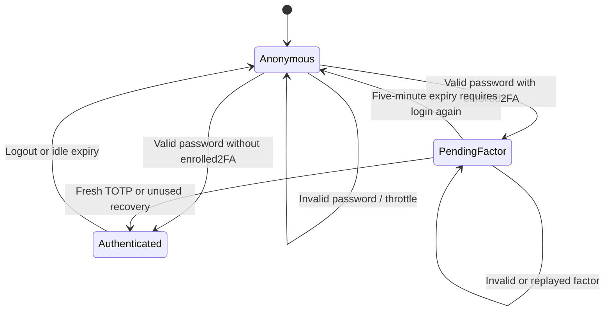

# Source walkthrough · follow the call, not just the filename

[Dashboard](README.md) · [Concept lessons](lessons.md) · [Dictionary](data-dictionary.md) · [Practice](exercises.md)

The files below are canonical runtime/source files. This folder contains explanations only.
The tour accounts for major functions, branches, utilities and test responsibilities in the inspected checkout.
No application changes or new learner implementation are implied by this walkthrough.

## 1. Entrypoints and the same mutation through two transports

| Source | Follow in source order | Why that order matters |
|---|---|---|
| [public/router.php](../../public/router.php) | API prefix → website root/index → verified assets →404 | Development routes never delegate arbitrary private paths to the built-in server |
| [public/index.php](../../public/index.php) | Bootstrap/actions → page allowlist → native POST wrapper → role/page gates → club lookup → layout | An action enforces its own access rules even before a page is rendered |
| [public/api.php](../../public/api.php) | REST flag/request ID → JSON helpers → bootstrap/actions → dispatch → exception mapping | Shared auth helpers know to return REST errors rather than HTML redirects |
| [public/.htaccess](../../public/.htaccess) | API rewrite | Apache production routing differs from PHP's development router |

The API entrypoint disables display_errors; the native entrypoint also depends on production PHP error configuration.
Bootstrapping errors cannot be safely diagnosed by publishing a stack trace.
Unexpected JSON exceptions are correlated with an opaque request ID in private logs.
PDO integrity code 23000 becomes 409; other PDO failures 503; remaining unexpected errors 500.
The HTML controller renders expected errors and generic fallback messages without exposing raw internals.

```mermaid
sequenceDiagram
    actor Student
    participant Browser
    participant Entry as HTML or REST entrypoint
    participant Service as perform_action + reserve
    participant DB as MySQL InnoDB
    Student->>Browser: Apply to a club
    alt Native form
        Browser->>Entry: POST action=join, id, csrf
        Entry->>Entry: handle_action checks hidden CSRF
    else Enhanced form
        Browser->>Entry: POST /api/v1/clubs/id/memberships, JSON {}
        Entry->>Entry: Route, identity, header CSRF, Origin, parser
    end
    Entry->>Service: join with validated id and session user
    Service->>DB: READ COMMITTED; BEGIN; lock club
    Service->>DB: Check relationship and approved capacity
    alt Invalid state
        Service->>DB: ROLLBACK
        Service-->>Entry: Domain failure
        Entry-->>Browser: Rendered error or JSON422
    else Allowed
        Service->>DB: Insert/reset pending + audit; COMMIT
        Service-->>Entry: action_result
        Entry-->>Browser: Native303 or JSON201 + UI redirect
    end
```

Joining alone does not approve membership. An administrator's separate review decides approval before community access.
Browser mapping lives in [app.js](../../public/assets/app.js); backend authority lives in the PHP services.
The same-origin cookie is carried automatically by the implemented fetch flow; header CSRF is still required.

## 2. Bootstrap: build a common boundary once per request

Read [app/bootstrap.php](../../app/bootstrap.php) beside this inventory.

| Region/function | Actual behavior and connection |
|---|---|
| ROOT / RequestError | Private package root; DomainException plus readonly HTTP status |
| Environment loop | Skip comments, split first equals, do not override a present process binding; values remain literal |
| config | Process value or explicit/default package setting, including localhost:8091 and sportshub_backup |
| mysql_version_supported | Reject MariaDB text case-insensitively; parse numeric version and require major ≥8 |
| db | Connect native PDO/utf8mb4, check engine before caching, set session timezone +05:30 |
| query / rows / one | Prepared execute, all rows or first nullable row; caller chooses trusted SQL structure |
| e | Escape HTML text/quoted attributes at output |
| go / flash | Internal 303 redirect and one-use session notice |
| user / require_user | Reload user from authenticated session; redirect native or REST 401 when absent |
| require_admin | Add role check; native 403/REST 403 when student |
| csrf / csrf_field / check_csrf | Session random token, escaped hidden form field, native mismatch 419 |
| audit | Insert actor/action/details; atomicity depends on caller transaction scope |
| text / date_input | Trim/Unicode length; strict datetime parsing and round-trip validation |
| positive / choice | Integer bounds; strict enum allowlists |
| when | Presentation formatting using configured timezone |
| HTTP session branch | Production HTTPS config guard, strict session/cookie/private path, headers and idle expiry |
| Final include | security.php declares primitives consumed by actions later |

The security helpers can refer to action_result even though actions is included afterward:
PHP resolves the function when that helper is invoked, after entrypoint setup has loaded both files.
Do not mistake that reference for a second independent authentication implementation.

Actual output-boundary source:

```php
function e(mixed $value): string { return htmlspecialchars((string)$value, ENT_QUOTES | ENT_SUBSTITUTE, 'UTF-8'); }
```

The cast permits ordinary scalar display, ENT_QUOTES protects both quote types, and ENT_SUBSTITUTE handles invalid UTF-8.
It does not authorize a record, bind SQL, or make arbitrary JavaScript string interpolation safe.

## 3. Actions: transport-neutral result, authoritative rules

[app/actions.php](../../app/actions.php) requires models and community services.
action_result returns redirect/message/data; handle_action checks native CSRF, dispatches, flashes and redirects.
perform_action handles the branches below, not just the first public registration branch.

| Branch in dispatch order | Trace and state change |
|---|---|
| community_* / moderate_post | Delegate to services that enforce their own club/admin gates |
| register | Validate fields/email/ID/password, throttle, reject duplicates, insert Argon2id hash with student schema default |
| login | Normalize email, throttle, verify password, rehash if needed; finish session or create pending factor state |
| verify | Require unexpired pending challenge, throttle, verify factor then finish authenticated session |
| require_user / logout | Remaining generic actions require current identity; logout clears state and rotates session |
| setup_2fa | Create unique temporary 20-byte base32 secret with ten-minute lifetime; not enabled yet |
| enable_2fa | Password+setup code; transaction saves encrypted secret/counter, eight hashes and audit; clear setup state |
| disable_2fa | Password+factor; clear enrollment/counter/recovery rows and audit; not one enclosing factor/removal transaction |
| join / register_tournament / attend | Fixed map to reserve memberships/registrations/attendance with session user ID |
| book | Future ordered, at most 4-hour interval/purpose; READ COMMITTED, parent resource lock, pending/approved overlap query, insert+audit |
| cancel | Allowlisted own relationship; eligible booking becomes cancelled, others delete under timing/status rules |
| require_admin / save | Administrator gate then metadata-driven save_entity |
| delete | Lock existing allowlisted parent; deletion and audit in one transaction; schema cascades may remove children |
| review | Validate entity/status/ID then transactional review_request |
| attendance | Require session started, update attended and audit |
| Unknown | Throw validation failure rather than silently succeed |

Public signup cannot accept role=admin through the API allowlist or insert such a role through this action.
Login uses a dummy hash for nonexistent accounts, but it differs in algorithm from real Argon2id hashes.
Do not claim that makes all account-existence timings perfectly indistinguishable.

Cancellation is not always deletion: booking history is retained; leaving a membership removes the relationship.
After leaving, club_access checks fail on subsequent requests.
Never demonstrate parent deletion on valued shared records just because the UI asks for confirmation.

## 4. Models: validate fields and serialize decisions

[app/models.php](../../app/models.php) contains four central functions.
entities is the trusted metadata for clubs,tournaments,events,resources, used by forms and API allowlists.
save_entity converts posted fields by type, validates related records and cross-field rules, then writes plus audit atomically.

Important actual limits: sport 60 characters, capacity 1..10000, description 5000, opponent 120 and paired scores 0..100000.
The current generic name limit 120 is stricter than tournament SQL name 140; UI/server/SQL limits are not universally identical.
A tournament deadline equal to its start is currently accepted because the check rejects only a later deadline.
Event scores require both values, kind=match and an opponent; score 0 is valid and must not be confused with null.

reserve selects one of three trusted paths:

- Membership: lock club; reject duplicate pending/approved; count approved capacity; create pending or reset rejected→pending.
- Tournament: lock tournament; require open/unexpired, unique user+tournament and capacity; insert registration.
- Attendance: lock event; require future session and approved club membership; prevent duplicate user+event; insert registered.

All finish with audit+commit or rollback on failure.
Tournament registration does not automatically insert every fixture's attendance row.

review_request validates memberships/bookings and approved/rejected, then follows a deliberate lock sequence:

1. Request READ COMMITTED before BEGIN.
2. Read the candidate to identify its parent; require pending.
3. Lock the club or resource parent.
4. Lock/reread the specific request; require pending and unchanged parent.
5. Fresh approved-count/overlap checks, then update+audit+commit.

This order matters when a competing approval commits while a reviewer waits.
The concurrency test explicitly starts workers under REPEATABLE READ to prove this function overrides its own transaction's isolation.
It does not change the session default for unrelated future operations.

## 5. REST helpers and route families

Read [app/api.php](../../app/api.php) with [the current API reference](../../docs/api.md).

| Helper/region | Role |
|---|---|
| public_user | Safe current-account projection excluding password hash/encrypted factors |
| json_response / json_error | Success/error envelopes, status and current metadata; 429 Retry-After: 900; exit |
| api_payload | Content-Type, bounded input, valid object/depth and scalar/null fields |
| api_fields | Reject unexpected keys before invoking an action |
| api_pagination / paginated | page 1..100000, per_page 1..100; count and bounded sorted collection |
| api_filter / api_record | Bounded string filters; trusted-table ID lookup or 404 |
| api_mutation | Adapt payload+fixed fields to action, resource readback, 2FA special response privacy |
| api_dispatch recognition | Positive-ID regex allowlist, allowed methods, 404/405 and Allow header |
| Middleware | Admin/personal gate, non-GET CSRF and supplied Origin, then parser |
| community_api call | Domain-specific routes/access handled before core branches |

Core route families cover health/session/account security; auth mutations; booking/reservations;
personal histories/cancellation; public club/tournament/event/resource lists/details;
results/standings; four-entity admin CRUD; membership/booking review; attendance; audit and reports.
Search fields are bound values, while entity/filter columns must be server-approved metadata.
Standings use generic 3/1/0 club points; reports are SQL aggregates, not invented analytics or automated brackets.
The generated [OpenAPI JSON](../../public/assets/openapi.json) documents 77 operations; it is not the executable router.
[bin/build-openapi.php](../../bin/build-openapi.php) generates it and must be reviewed when a contract changes.

## 6. Security functions: encoding, verification and persistence

[app/security.php](../../app/security.php) groups base32_encode/decode, totp/totp_counter,
app_key, encrypt_secret/decrypt_secret, throttle, finish_login and verify_second_factor.
Follow the [lessons](lessons.md) for the mathematics/storage distinction, then trace actual callers in actions.



finish_login rotates ID, replaces session with user_id/last_active/fresh csrf, audits and chooses role destination.
verify_second_factor locks the user, then stores a fresh counter or deletes one matching recovery hash before commit.
A code being mathematically correct does not mean it is eligible after replay or challenge expiry.
throttle buckets scope+identity+REMOTE_ADDR for eight attempts/15 minutes; count+insert is not an atomic distributed limiter.

## 7. Community services and privacy

[app/community.php](../../app/community.php) supplies a full domain service beside core actions.
club_access requires administrator or approved membership in the exact club; community_post enforces club/post association and visibility.
community_body validates text; community_summary counts members/posts/upcoming sessions; community_posts projects feed data/counts.
community_action wraps perform_community_action in READ COMMITTED plus transaction/rollback.

The dispatcher covers post/edit/delete/comment/comment-delete/react/unreact/report.
It locks a post before visibility-dependent child work, enforces authorship and accepts an admin deletion override.
Author editing never resets hidden status. Deletion erases body and children but leaves an unrestorable deleted tombstone.
Reaction PUT is idempotent through unique membership of post/user; reports are one per user/post.
moderate_post requires admin, locks nondeleted content, writes visible/hidden+reason, resolves reports and audits atomically.
community_api handles summary/roster/posts/comments/reactions/reports and separate private admin moderation/report projections.
Roster exposes names/faculty/join date, not student IDs/emails/factors; report reasons are not part of the member feed.

## 8. Utilities and tests: select the right scope

| Source | Purpose / execution boundary |
|---|---|
| [setup.php](../../bin/setup.php) | CLI creates private .env/new random key only if absent; does not overwrite an existing dataset's key |
| [migrate.php](../../bin/migrate.php) | CLI advisory-lock/versioned additive schema setup; DDL may implicitly commit |
| [seed.php](../../bin/seed.php) | Exact development-only sports sample; skips when clubs exist; no shared login password |
| [create-admin.php](../../bin/create-admin.php) | Private CLI process credentials; creates new admin, preserves an existing account |
| [demo-users.php](../../bin/demo-users.php) | Optional development+--confirm-demo provisioning with random private credentials; never production evidence |
| [doctor.php](../../bin/doctor.php) | Readiness: extensions/key/engine/timezone/all 17 tables/private storage; not all-feature verification |
| [build-openapi.php](../../bin/build-openapi.php) | PHP-only static contract generation; no database or credentials required |
| [security.php](../../tests/security.php) | Public vectors/synthetic key/hash/escape/version checks; no SQL reset |
| [audit.php](../../tests/audit.php) | Read-only stack/local-link checks; not browser/external-link/anchor validation |
| [fixtures.php](../../tests/fixtures.php) | Guarded reset and synthetic rows only in sportshub_backup_test; not public provisioning |
| [integration.php](../../tests/integration.php) | Real HTTP/actualMySQL native+REST verification; explicit reset flag; owns port 8092 |
| [concurrency.php](../../tests/concurrency.php) | Two-connection approval lock-wait regressions; same disposable schema/reset flag; run sequentially |

Do not execute a file merely because it is listed here. Read its guard/state effects first.
See [exercise safety gates](exercises.md) and record actual current outcomes separately from historical validation.
