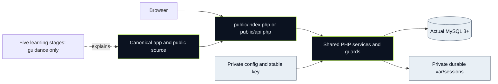

# Stage 05 · Assemble, verify and prepare a real release

[Learning map](../README.md) · [Start here](../00-start-here.md) · [Solo path](../solo-path.md) · [Source map](../source-map.md) · [Learning validation](../validation.md)

**Mission:** make one existing SportsHub application reproducible, understandable and reviewable before a human authorizes its release. Assembly means wiring the canonical PHP entrypoints, shared services, database and private configuration together. Nobody copies four learning folders into a new production application.

**Starting point:** source inspected at `f455575` on `main`. This stage adds educational material; it does not claim that setup, tests, backups or deployment were performed by reading it. The existing application is a Codex-assisted baseline. A learner's real changes and explanations must be recorded separately.

## What you will be able to explain

- Why PHP serves `public/` while `.env`, services, scripts and sessions remain private.
- How a student's membership request crosses HTML, JavaScript or native POST, PHP authorization and MySQL.
- Which setup commands create configuration or data, and which checks only inspect it.
- Why `sportshub_backup_test` can be reset only after confirming that it is disposable.
- How eight people can work in parallel without claiming ownership of pre-existing modules.
- What a genuine PHP/MySQL host, stable encryption key, durable sessions and tested recovery require.
- Which release/report/video items remain unfinished until a human supplies real evidence.

## Open the stage in this order

| Open | Purpose | Observable outcome |
|---|---|---|
| [lessons.md](lessons.md) | Setup, integration, teamwork and release reasoning | A coherent environment and release plan, not just command copying |
| [source-walkthrough.md](source-walkthrough.md) | Actual startup scripts, entrypoints, tests and service connections | You can follow an input to its row change and response |
| [exercises.md](exercises.md) | Prediction-driven labs, hints and evidence checks | Personally observed, reproducible results with safe cleanup |

Prerequisites: basic terminal navigation, PHP variables/functions, SQL tables and a browser's Network panel. If those are unfamiliar, use the earlier stages and [shared resources](../resources.md) before attempting a release. H's selected API/authentication/security role benefits from this stage because it joins those controls to runtime configuration and operational evidence.

## The one-application map

Dotted arrows denote explanation, not PHP includes. The application never imports these learning guides to run. Different developers may have separate private local installations of this same source; that is different from four diverging deployable applications.

## Keep the environments distinct

| Purpose | Correct root/URL | Database and state |
|---|---|---|
| Native development | Repository root; `http://localhost:8091`; document root `public/` | Own `sportshub_backup`, private root `.env`, local `var/` |
| Optional local Docker | Same source; `http://localhost:8095` by default | Project `finalsubbackup-local`; private helper settings and persistent volumes |
| HTTP verification | Runner starts its own server on 8092 | Literal disposable `sportshub_backup_test`; explicit reset flag |
| Real release | Actual verified HTTPS origin supplied later | Fresh production database/key at first release; stable matching state afterward |

Ports do not isolate cookies. This edition has its own cookie name, but native and Docker copies of this edition still share that name on localhost. Use separate browser profiles or run one at a time when comparing installations.

## A bounded path for H working alone

If teammates cannot help, prioritize a complete vertical slice before polishing every screen. Follow [the solo path](../solo-path.md) and preserve the working baseline:

1. Run the agreed source locally; confirm doctor, health, login and separate roles.
2. Explain membership → approval → community, including both mutation paths and refusal states.
3. Review the required sports workflows, run suitable safe checks and record genuine findings.
4. Prepare a host capability decision and an honest report/video checklist; release only after authorization and verified prerequisites.

Narrow optional feature work before cutting authentication, role checks, CSRF, database safety or required Topic 3 workflows. A realistic limitation in a report is better than an invented success or a rushed public server exposing private files.

## Stage evidence checklist

- [ ] I identified the actual checkout, commit, engine, URL and PHP configuration without exposing secrets.
- [ ] I can explain the distinction between native 8091, Docker 8095 and test 8092.
- [ ] I traced one shared action through native and REST callers.
- [ ] I classified every command I ran as inspection, local setup, disposable reset or release action.
- [ ] I saved my actual results and any failures/skips, not inherited pass counts.
- [ ] I named shared-file reviewers and recorded only real personal work.
- [ ] My release decision addresses public root, HTTPS, MySQL, key/session persistence, backup and rollback.
- [ ] Report names, release date, deadline and live/video links remain unfilled until verified.

## Canonical references

For exact platform installation use [local setup](../../docs/local-setup.md). The [root optional Docker recipe](../../README.md#optional-docker-setup--isolated-local-development) remains the single recipe for its four ignored helper files. Use [hosting/security](../../docs/security-and-hosting.md), [build order](../../docs/build-order-and-contributions.md), [eight-member plan](../../docs/eight-member-plan.md), [report/video](../../docs/report-and-video.md) and [validation history](../../docs/validation.md) for their respective facts. This stage teaches how those pieces fit together rather than claiming a new runtime or deployment.
