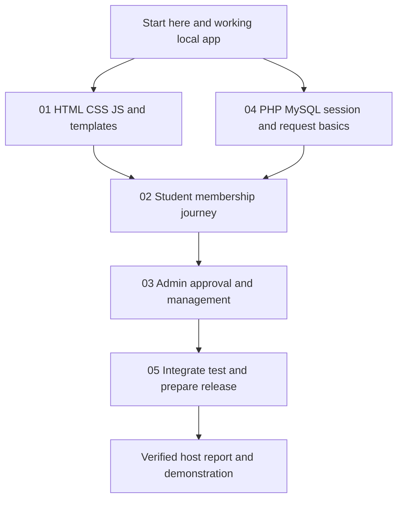

# Learn NSBM SportsHub, one verified step at a time

This is the learning home for **`Ckstr-arch/FinalSubBackup`**, reviewed against application baseline `f455575` on **4 November 2026 (Asia/Colombo)**. It teaches the application that actually exists here: server-rendered PHP, HTML, CSS, vanilla JavaScript and **MySQL 8+**. This edition rejects MariaDB. The application lives at the repository root; there is no `backup/` wrapper to enter.

The five stages mean the earlier four learning tracks **plus assembly as stage five**. They are a reading and contribution structure, not five different websites or five assignment topics. The selected assignment remains Topic 3, Sports Club Management System.

You do not need to memorize the whole repository before starting. Learn one request, explain it, change one bounded thing, and verify the result. A small understood change is a useful unit of progress.

## Begin here

1. Follow [Start here](00-start-here.md) for orientation, setup and your first browser-to-database trace.
2. Choose the [solo path](solo-path.md) if you may need to finish independently. The order changes by dependency rather than requiring you to complete every chapter before coding.
3. Open a stage below. Read its README, lessons, source walkthrough and exercises in that order.
4. Keep your own [learning and evidence log](learning-log.md). Unchecked boxes are prompts, not evidence that something is unfinished in the existing app.

| Stage | What you will be able to do | Start | Team mapping |
|---|---|---|---|
| 01 — Frontend and UX | Explain and change semantic HTML, PHP templates, CSS, themes, responsive navigation and browser JavaScript | [Frontend and UX](01-frontend-ux/README.md) | A: shared markup; B: CSS/browser UI |
| 02 — Student experience | Trace student forms, membership state, enrollment, bookings, history and private club communities | [Student experience](02-student-experience/README.md) | C: student screens; D: student services |
| 03 — Admin operations | Understand management CRUD, approvals, scores, attendance, reports, moderation and audit effects | [Admin operations](03-admin-operations/README.md) | E: admin screens; F: admin services |
| 04 — Backend, database and security | Explain PHP/PDO, relational data, transactions, REST, sessions, CSRF, authorization and 2FA | [Backend, database and security](04-backend-database-security/README.md) | G: database/data layer; **H: API/auth/security — your chosen part** |
| 05 — Assemble and deploy | Integrate one canonical app, verify it, contribute honestly, prepare hosting, recovery, report and demonstration | [Assemble and deploy](05-assemble-deploy/README.md) | Shared integration; no ninth student required |

**A–G are proposed responsibility slots, not assigned names or claims of finished work.** H is your selected responsibility. Eight students includes you. The [existing team plan](../docs/eight-member-plan.md) and [contribution log](../docs/contribution-log.md) remain the record for real assignments and work.

## How the pieces connect

Stage 04 starts early because the interface and the database meet there. Stage 05 is also a reference from day one: use its setup and test guidance before executing commands. You can return to advanced security/concurrency topics after the membership journey is understood.

## Reference shelf

- [Source map](source-map.md): every baseline tracked file, its role and primary learning home.
- [Glossary](glossary.md): plain explanations of the terms used throughout the code.
- [Resources](resources.md): selected official tutorials, specifications and tools with a purpose for each.
- [Validation and limits](validation.md): what was checked for these guides and what still needs real execution.
- [Current architecture](../docs/architecture.md), [API contract](../docs/api.md), [assignment traceability](../docs/requirements-traceability.md) and [hosting runbook](../docs/security-and-hosting.md): existing project references.

## A repeatable learning loop

For each lesson, **predict → inspect → run → explain → record**:

1. Predict what a request or code fragment does before running it.
2. Locate the real function, its callers and its data. The live source takes precedence if it has changed since this guide's review.
3. Observe the expected success and at least one meaningful failure using synthetic local data.
4. Explain why the result happened, including the server-side rule.
5. Record your own patch or investigation, actual test outcome and a short explanation. Commit only work that happened.

Examples are teaching fragments unless identified as exact source excerpts. They do not replace complete functions. Exercises are **proposed work**, not already implemented features or commands automatically executed by reading the guide. Work on a task branch for experiments; the working prototype remains the baseline.

## Boundaries to keep while learning

- Keep the application stack within the assignment: HTML, CSS, JavaScript, PHP and actual MySQL. No frontend framework, package manager or alternate backend is needed.
- Protect `.env`, `APP_KEY`, sessions, passwords, 2FA secrets/recovery codes and database exports. Screenshots should use synthetic data and exclude secrets.
- Optional resetting suites are for the deliberately disposable `sportshub_backup_test` database only. Follow the [test instructions](../docs/local-setup.md) before running them; do not run integration and concurrency suites together.
- Preserve the baseline's assistance attribution. Existing code does not become a student's original contribution when copied or assigned a new owner.
- Local success is not a hosted release. Deployment needs verified HTTPS, supported hosting, private storage, backups and actual host acceptance checks.

Your first finish line is modest: start the app, trace one page and one membership request, then explain where each decision is enforced.
