# A practical solo path, with room for help

[Learning home](README.md) · [Start here](00-start-here.md) · [Evidence log](learning-log.md)

This route is for understanding and completing the project even when help is uncertain. It does not require rewriting a working application from scratch. Keep the existing assisted baseline, learn the parts you need to explain, and make bounded, genuine improvements. If teammates become available, hand them a task with a clear interface and finish check.

No deadline or available hours have been confirmed. The sequence below uses dependencies and observable finish lines rather than an invented calendar. Deployment/report/video are part of the assignment, so reserve time for them before adding optional features.

## Decide which mode you are in

| Mode | What you do | What you do not claim |
|---|---|---|
| Learn the supplied prototype | Trace existing behavior, run local observations, explain files | That reading or copying makes you its original author |
| Improve the prototype | Agree a scoped task, patch it, test it and record the evidence | That a proposed task or unrun test has passed |
| Rebuild for understanding | Recreate one small component in an isolated scratch location, compare with baseline | That five stage folders are five deployed applications |
| Prepare submission | Verify requirements, host, report, screenshots, contributions and video | That a GitHub push is a live PHP deployment |

The first two modes are usually the safest way to finish reliably under time pressure. An isolated exercise can clarify a concept without replacing every working feature.

## Dependency order and finish lines

| Pass | Read and practice | Concrete finish line |
|---|---|---|
| 0 — establish a baseline | [Start here](00-start-here.md), [Stage 05](05-assemble-deploy/README.md), native or Docker setup | App opens; doctor prerequisites understood; one synthetic student and private admin available; local state preserved |
| 1 — understand the shell | [Stage 01](01-frontend-ux/README.md): markup → CSS → UI JavaScript → PHP templates | Explain and make one safe component change; desktop/mobile, both themes and keyboard checked |
| 2 — understand the server basics | [Stage 04](04-backend-database-security/README.md): PHP values/functions, request/response, session, PDO, keys | Trace one prepared read and one validation failure; describe cookie/session/CSRF roles |
| 3 — complete one vertical flow | [Stage 02](02-student-experience/README.md) membership plus [Stage 03](03-admin-operations/README.md) approval | Register → login → pending membership → admin approval → exact-club access demonstrated, including forbidden pending access |
| 4 — cover required business features | Student/admin lessons and [requirement traceability](../docs/requirements-traceability.md) | Scheduling, tournament enrollment, scores/standings, bookings/collision and participation/report flows explained and checked |
| 5 — strengthen H, your chosen area | Stage 04 security/API walkthrough and focused exercises | Explain payload/role/CSRF/2FA boundaries and personally implement or investigate one scoped API test task |
| 6 — verify and deliver | [Stage 05](05-assemble-deploy/README.md) testing, hosting, report and demo | Actual test outcomes saved, compatible live host verified, backup restored in isolation, real report/video/source links accessible |

Follow the first column in order. You may revisit individual chapters. Passing the membership flow is a reason to move forward, not a reason to rewrite it with a new framework.

```mermaid
flowchart LR
    Local[Working local baseline] --> Shell[Understand one page]
    Shell --> Request[Understand one request]
    Request --> Member[Student applies]
    Member --> Admin[Admin approves]
    Admin --> Access[Member enters club]
    Access --> Coverage[Other required journeys]
    Coverage --> Evidence[Tests and explanation]
    Evidence --> Release[Verified hosting and submission]
```



## Build a feature in small passes

If you must recreate or change a component, use this order:

1. **Describe the outcome.** For example, a signed-in student should see whether a club application is pending or approved.
2. **Write the minimal semantic markup.** Heading, description, status, labelled button/form and an empty state. Use fictional static values only for this first isolated sketch.
3. **Apply CSS.** Reuse tokens and spacing; check a narrow screen, dark/light and focus visibility.
4. **Add local JavaScript only where useful.** Toggle or disclosure behavior belongs here. Authorization and capacity rules do not.
5. **Connect PHP data.** Replace fictional values with the existing query/helper; escape output. Confirm empty and multiple rows.
6. **Use the native server action.** Session/CSRF/permission/validation/transaction are the foundation. Understand its redirect and failure behavior.
7. **Check the existing REST enhancement.** Match the actual action-to-route mapping; both interfaces must enforce the same rule.
8. **Verify an important negative case.** A different user's request or stale pending state must not bypass the server.
9. **Explain and save evidence.** Record actual file/function, observed result, patch and review. Use a real commit for actual completed work.

You are extending one application at every step. Do not create separate new student/admin databases or clone production services into the `learn/` folders.

## Prioritize when time is tight

| Priority | Examples | Decision |
|---|---|---|
| Required and release-critical | PHP/MySQL compatibility, secure login/roles, core CRUD, membership approvals, booking rules, live access | Resolve and verify before submission |
| Required evidence | Real contribution record, screenshots, report, accessible source/live/video, each member's explanation | Schedule and verify explicitly |
| Existing extensions | Authenticator 2FA, dark/light, member community | Preserve working behavior; learn the security-sensitive parts before changing them |
| Optional expansion | New chat, notifications, redesign, automated sport-specific brackets | Defer unless the required flows and delivery evidence are already sound |

If a required feature fails, diagnose one reproduction and one responsible source path. Do not spend the final working session changing the entire navigation color palette while login or hosting is broken.

## Use teammates without making your progress depend on them

Give each person a bounded task card:

```text
Outcome:
Exact file/function or page branch:
Inputs and expected outputs:
Required server rule:
Files that require coordination:
Success observation:
Negative observation:
Reviewer:
Actual result and PR link (fill after work):
```

For example, B can improve a menu's keyboard behavior while G reviews a schema relationship. C and E both touching `app/views.php` must agree exact page branches. D, F and H must coordinate the specific action/helper and integration-test section they edit. A different role letter does not eliminate file conflicts.

If someone cannot finish, record the actual state, take over a clearly identified task and retain truthful authorship. A review, test investigation or explanation can be a legitimate contribution when it really occurred; copying the baseline into eight commits does not prove eight people developed it.

## Your H first task without getting stuck

1. Learn the membership flow before starting with advanced cryptography.
2. Read `api_payload()` in [app/api.php](../app/api.php) and the [API contract](../docs/api.md).
3. Follow the Stage 04 exercise for missing raw-parser regression cases. The helper that always JSON-encodes a valid object cannot test malformed raw JSON; use the raw request helper with a live cookie/current CSRF token.
4. Run tests only against the confirmed disposable test database following setup guidance. Preserve valued data.
5. Finish with a personally understood patch and real outcomes, or a precise recorded blocker. Do not simply claim that existing authentication was newly authored by you.

## A useful stopping rule

Finish a session when you can name:

- One thing you can now explain without copying the guide.
- One result you actually observed.
- One bounded next step with a finish condition.

If stuck, write the URL, expected result, actual status and relevant function. Remove secret values. That turns a vague problem into a question another person can help answer. Tiredness is a reason to shorten the next task, not evidence that you cannot learn the project.
